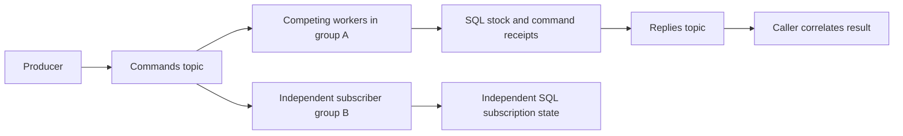

# Actors, messages and durable delivery

This increment adds an independent Go actor runtime and actual process/broker experiments over the same inventory-shaped receive/reserve transition. Local and remote actors share a `Sender` interface, while a PostgreSQL processor supplies a separate durable alternative. Production Inventory remains the owning application context; the lab does not replace its feature or silently introduce another owner.

From the repository root:

```sh
make up
make verify ID=C05-06
```

Go 1.27.3, GNU Make, Docker/Compose and the existing local `atlas_test` binding are required for the complete check. `make actors-demo` needs no database or Kafka; it builds the actual lab executable and runs the transient process drill. `make actors-postgres` runs three isolated PostgreSQL tests. `make integration-actors` starts the dedicated pinned Kafka profile on loopback **19094**, runs the broker drill, then removes only that profile and its synthetic volume. It creates/drops a fresh owned database and fresh topics/groups, and never skips unavailable services.

An already-running local Kafka can be selected explicitly:

```sh
ATLAS_ACTORS_BROKERS=127.0.0.1:19094 make verify ID=C05-06
```

Only the local development/test listeners 19092..19094 are accepted. The external-broker path leaves that broker running and deletes only the topics/groups created by this run. The standard Compose path has no host-JVM prerequisite. Private `.env` is loaded by the guide without shell-sourcing credentials. Database creation/drop privileges are required for the disposable fixtures.

## What the actor runtime guarantees

An entity key contains **tenant, warehouse and SKU**. The default warehouse alias normalizes before lookup and hashing. `Resolve` activates at most one local cell for that key in a runtime. Each cell owns one processor and runs one message at a time. The pure [stock transition](../labs/ch05/actors/stock.go) is shared by memory and PostgreSQL processors.

| Mechanism | Implemented behavior |
|---|---|
| State isolation | Encoded input is copied and decoded before admission; callers do not share mutable stock objects or byte buffers with a processor. Replies are value snapshots. |
| Scheduling | One goroutine per activated entity, bounded by the registry. A blocked BOOK actor does not stop another entity's processor. |
| Ordering | One mailbox processes its accepted messages serially. Concurrent senders have no promised global order, and unrelated actors/nodes are independent. |
| Backpressure | A full mailbox rejects admission immediately. The default queue holds 16 messages plus one currently executing; the process drill uses capacity one. |
| Registry bound | Default 32 actors, maximum 64. Stopped cells retain their budget state; repeated resolution cannot bypass a poison actor's restart limit. |
| Receipt horizon | Default last 128 successful command IDs per actor; bounds 1..128. A retained duplicate returns its original response; a changed complete canonical payload conflicts. Eviction and restart end that memory-only horizon. |
| Supervision | Processor panics restart that actor with empty memory and a new generation, dropping queued old-generation messages. Default budget is three restarts per minute; the drill uses one restart. Business rejections are returned normally. |
| References | Tenant/entity key, random process incarnation and generation fence old addresses. Restarting on the same network port cannot revive an old reference. These are local fences, not cluster ownership leases. |
| Dead letters | Bounded ring of message IDs, references and reasons; default 32, maximum 128. It is diagnostic memory, not a durable replay queue. |
| Resource admission | Messages at most 4096 bytes, JSON depth six, 128 visited value tokens, 16 keys per object, eight array elements and 512-byte string values. Notes additionally cap UTF-8 size at 128 bytes. |

The actor transition refuses invalid quantities, overflows and reservations beyond available stock. One hundred simultaneous local reservations produce ten successes and ninety insufficient-stock results after a ten-unit receipt. The PostgreSQL suite separately runs two independent actor owners against the same key: row locking and receipts, rather than local actor scheduling, preserve that invariant across owners.

## Tell, Ask and failure

`Tell` returns after **volatile mailbox admission**. Remote HTTP returns 202; the effect may run later or disappear if the node dies. The sender receives no processing result. `Ask` waits on a separate response channel. Stopping that wait does not retract an accepted message: processing has a runtime-owned lifetime, not the caller's waiting context.

The real process drill pauses a node after mutation but before reply. The caller's 200 ms deadline expires, then a same-ID retry resolves the saved in-memory response once the node resumes. A second checkpoint pauses processing before an effect, fills the one-entry queue and verifies that a third send is rejected. Another entity still makes progress. Actual SIGKILL then destroys prior memory and both admitted transient messages; a replacement on the same port starts with empty state and rejects the old incarnation's reference.

Cancellation differs deliberately from the [direct RPC adapter](RPC.md): RPC propagates its request context through the use case, while actor Ask cancellation ends waiting. An actor system needing business cancellation must model it explicitly, including whether a committed effect can be compensated. Runtime shutdown cancels cooperative processors; Go cannot forcibly kill an arbitrary blocked goroutine. The fixture uses actual process termination for a hard crash.

Single-threaded execution avoids shared-state races inside one actor. It does not persist stock, keep queued messages across a process kill, prevent a second node from activating the same entity, or deduplicate an ID after its cache entry disappears. The drill records independent states for the same entity on two nodes and a deliberate reapplication after receipt eviction.

## Durable Kafka comparison



The producer knows a broker address and logical topic, not a recipient process address. Kafka acknowledges three real records while all consumers are absent; no business stock exists yet. It buffers work and later redelivers to replacement workers. Publisher acknowledgment means broker acceptance, not actor completion.

The dedicated [profile](../deploy/compose/actors/compose.yaml) pins Kafka 4.1.1. Every run creates three-partition command/reply/relay topics with **replication factor one**, 24-hour delete retention and 8192-byte broker record limits. Producers use all-ISR acknowledgments and bounded buffers/timeouts. With one replica, this is a real persistent broker comparison, without a replicated durability or physical power-loss claim.

Two actual workers in one consumer group receive disjoint nonempty partition assignments and both process commands. A later independent group replays the retained messages and builds the same three entity states. These demonstrate the two book distribution patterns: competing consumers share work; independent subscriptions each receive it. Kafka keeps acknowledged history until retention/deletion, unlike queue implementations that remove an acknowledged message. This finite topic is not an indefinite event-sourcing archive; Ordering's immutable application journal has its own contract.

Records are keyed by normalized `tenant/warehouse/SKU`, using FNV-1a modulo three. This keeps each entity on one partition for the fixture's fixed topology. Partition-count changes, migration and broader broker routing remain Chapter 7/12 work. The consumer blocks rebalance delivery while processing a record, then explicitly allows it after completion. Replacement assignment can take longer than a killed member's six-second session lease; checkpoint budgets include that actual delay.

The durable processor commits **stock, the complete command receipt, original encoded body, saved result and processing-attempt metadata in one PostgreSQL transaction**. Actor scheduling and SQL durability remain separate layers. Each subscription has independent state and receipts. Message IDs are scoped to subscription/entity, while Kafka offsets identify physical deliveries.

The native drill SIGKILLs one consumer before SQL commit and a second after SQL commit but before source acknowledgment. The first leaves no target effect. The second leaves one saved effect; Kafka redelivers to a replacement, which returns that result without applying stock twice. The target accumulates multiple physical processing attempts, including a replay, while retaining one logical effect. Publishing the same ID/body as a second Kafka record also creates a new offset without another stock receipt. Two independent subscriptions finish with **six logical receipts each**.

The durable path performs:

1. Commit the local stock effect, source bytes, result and command receipt.
2. Publish a reply with message ID, entity key and subscription for correlation.
3. Commit the source consumer offset.

This creates an RPC-like result over a **separate reply topic** without making publication synchronous with consumer execution. A crash between steps can duplicate replies or redeliver a source record. Local SQL deduplication does not make external actions or the reply stream globally exactly-once. Failures stop this finite consumer without acknowledging the failed record; production quarantine, terminal rejection policy, retry horizons and operator repair need the existing application patterns and remaining Chapter 12 work.

## Schemas and rolling messages

The authored [AsyncAPI 3.0 contract](../api/asyncapi/actors/asyncapi.json) describes commands, replies, channels, request/reply correlation and payload schemas. Its embedded independent-lab copy is reproducible, and actual published commands and replies pass those JSON Schema components. Runtime preflight enforces additional byte/token/depth bounds. Kafka itself stores opaque bytes and metadata; it does not validate these business schemas.

Two typed JSON writer/reader profiles model a compatible optional annotation. Four real writer-to-reader combinations preserve all common stock transitions. Reader 1 ignores the annotation; reader 2 exposes it. The profiles run as actual nodes from one lab executable and are not claimed historical releases. A new business meaning needs a new supported operation version, rather than an unknown annotation silently changing stock semantics. Unknown formats, operations and unsupported writer profiles reject before mailbox admission.

The broker relay exercise republishes a current message twice: once as its complete original bytes and once reconstructed through the older typed structure. The raw relay preserves the note; reconstruction loses it. Receipt hashes cover the full canonical payload, including unknown annotations, so that rewritten same-ID body conflicts instead of replacing saved source history. The first consumer also persists original bytes despite using the old reader profile. Formatting and writer metadata are distinct from command meaning; IDs, operation and normalized key remain stable across a retry.

The known profiles and AsyncAPI definitions are repository contracts. An external schema-registry service is not deployed by this increment; the earlier [Avro registry/archive lab](AVRO.md) supplies the explicit writer-schema lookup example. Central compatibility policy, multilingual SDKs and external schema governance remain in the full audit.

## Framework and broker choices

Akka, Orleans and Erlang/OTP combine actor execution with varying placement, messaging, supervision and persistence facilities. This Go runtime demonstrates isolation, supervision, bounded admission and encoded local/remote sends. Cluster directories, placement leases, rebalancing actors, automatic durable activation and snapshot recovery require separate implementations. Using one convenient local/remote interface does not erase loss, latency or version boundaries.

Commercial TIBCO/WebSphere/webMethods, open-source RabbitMQ/ActiveMQ/HornetQ/NATS/Redpanda/Kafka, and cloud Kinesis/Azure Service Bus/Google Pub/Sub differ in delivery, retention and operational guarantees. The lab executes Kafka's retained-log consumer-group model; those alternatives are a comparison exercise and remain in Chapter 12's complete broker scope. Backend selection must state acknowledgment, retention, fan-out, ordering and recovery assumptions.

Reports are `artifacts/actors.json` (**13 transient observations**) and `artifacts/actors-broker.json` (**15 broker observations**), with actual executable/source hashes and private checkpoint/assignment files in `artifacts/actors-run-*`. The [chapter mapping](chapters/ch05/actors-and-messages.md), [decision](adr/0021-actor-lifetimes-and-durable-message-boundaries.md), [runbook](runbooks/actor-recovery.md), [scenario](../scenarios/actor-messaging.json) and [validation](VALIDATION.md) retain the evidence. C05-06 remains in progress pending its full semantic, framework, interoperability, scale and operations audit; all 88 original packages remain in scope.
