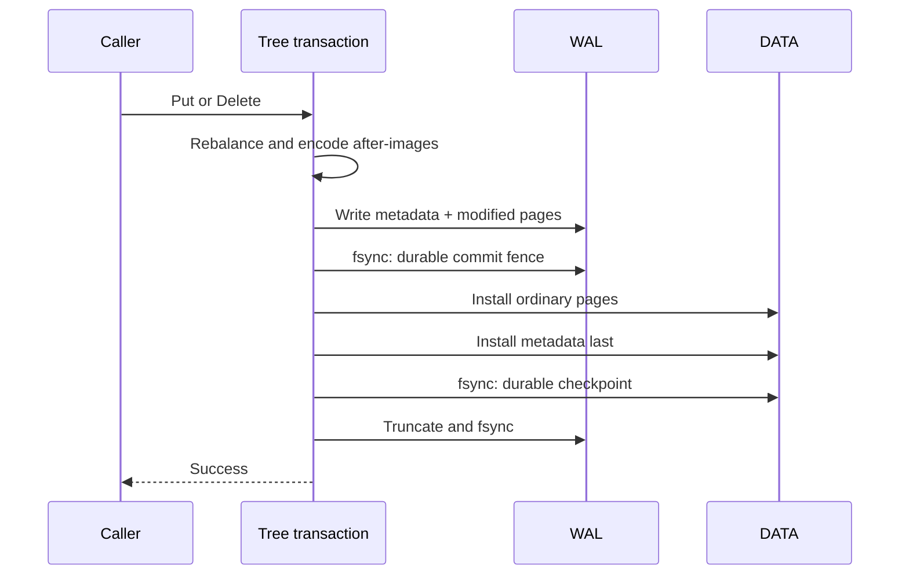

# Page-based B+ tree lab

The custom Go tree stores warehouse snapshot keys in bounded 4 KiB pages. It implements search, leaf and branch splits, borrowing and merging on deletion, root growth/collapse, linked-leaf range scans, a persistent free-page list and WAL-based recovery. It joins the append-log, LSM and bbolt alternatives in the storage comparison. The application's authoritative data remains in PostgreSQL.

## Run

These commands need Go 1.27+ and the verified Linux filesystem contract, without application services or credentials:

```sh
make verify-btree
make verify ID=C04-02
go run ./cmd/guide verify-btree
```

The commands run race-enabled tree tests and generate `artifacts/btree.json`. `make storage-demo` now compares all five stores and writes `artifacts/storage.json`. CI retains both reports. Temporary databases are owned children beside the report, or under an explicit `-workdir`; the runner never adopts or resets an existing database.

```sh
cd labs
go run ./cmd/lab btree -rows 2048 -runs 3 -output ../artifacts/btree-large.json
```

## Page and tree rules

| Rule | Current implementation |
|---|---|
| Page size | Exactly 4,096 bytes, including header and trailing CRC32C |
| Header | Version magic, page ID, page generation, kind, slot count, payload length and sibling/free-list pointer |
| Page kinds | Metadata at page 0; leaf, branch and free pages at positive IDs |
| Keys and values | Nonempty byte keys up to 128 bytes; inline values up to 256 bytes, including empty values |
| Capacity | Persisted even maximum of 4, 6 or 8 keys; default 8, with at most 9 branch children |
| Occupancy | Non-root leaves hold at least half capacity; branches hold at least half capacity plus one children; a branch root has at least two children |
| Separators | Each separator equals the minimum key in its right child; all subtrees have disjoint ordered ranges |
| Leaf chain | Forward sibling links match the tree's in-order leaf sequence |
| Allocation | Every page below the allocation high-water mark belongs to the tree or the persistent free list |
| Bounds | At most 65,536 pages including metadata, depth 16 and 64 after-images in a redo transaction |

The small capacity is deliberate: it exercises multi-level splits and merges with short datasets and guarantees that worst-case inline records fit. This is not a space-optimized B+ tree. Variable-length slots are encoded compactly inside each fixed page, with zero padding. Overflow values, denser layouts and broader format/scale stress remain further work.

`Check` validates the complete structure: occupancy, separator minima, depth, key count, leaf links, generation bounds, free-list acyclicity and complete page accounting. Reopening always runs this check. Point/range reads return owned byte copies; the tree does not expose borrowed page memory or multi-call snapshots.

## Synchronous redo protocol

Each changed `Put` or `Delete` builds its modified pages in memory. No data page changes until the complete checksummed redo transaction is durable. A delete of an absent key is a durable no-op and does not advance the generation.



The WAL holds at most one pending transaction. Its header and body have separate CRC32C checksums. The body carries a database identity, generation, metadata page and sorted unique after-images. Pages also carry their own checksums, IDs and generations. The hashed `CONTROL` descriptor records format, order and database identity; it is immutable after initialization completes. Its ready flag distinguishes interrupted initialization from missing files in an established database.

On reopen, the tree reads the WAL before trusting the data metadata. A valid redo record can therefore repair a torn leaf, branch or metadata page. It validates the intended complete tree through an after-image overlay before installing anything. Recovery is idempotent: it can be interrupted during page installation and run again. A complete data file is synced before the WAL is cleared. Stale, skipped-generation or foreign redo is rejected.

An incomplete WAL append can be discarded only after the existing data tree passes full validation. A complete checksum-invalid record fails closed. A missing registered WAL is an error. The engine never guesses a root from filenames or falls back to an older page set.

An I/O/failpoint error after log mutation returns `ErrRecovery` and poisons the handle. Close and reopen the same directory. The last operation may be committed even when its caller received an error; earlier acknowledged changes must survive under the stated fsync/rename contract. There is no asynchronous mode or public multi-key transaction API.

## Free pages and concurrency

Merges and root collapse turn removed nodes into checksummed free pages. The metadata records the list head/count, and an allocation consumes that list before extending the file. Free-page changes participate in the same redo transaction as the tree changes. The data file keeps its high-water allocation; reclaiming a page enables reuse rather than file shrinkage.

One advisory lock excludes another handle/process, and one in-process mutex serializes reads, writes and checking. This makes in-place page installation observable only after a complete method returns. It does not implement page latch crabbing, concurrent readers during mutation or MVCC. The [chapter walkthrough](chapters/ch04/page-based-btree.md) compares those techniques with this design and bbolt's copy-on-write pages.

The [recovery runbook](runbooks/btree-recovery.md), [decision](adr/0009-page-redo-and-free-list.md) and [validation](VALIDATION.md) identify the evidence and limits. Process kills retain the OS page cache. The shared filesystem model supplies explicit power-loss and torn-write schedules; physical storage certification remains outside this lab. C04-02 remains in progress pending its full sub-concept audit and remaining format/scale work.
