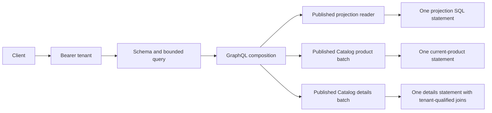

# GraphQL over published read contracts

`POST /v1/graphql` composes Ordering projections and current Catalog products/details using **graph-gophers/graphql-go 1.11.0**. It uses the same tenant bearer authentication as REST. The adapter imports published contracts and shared platform code; each context owns its PostgreSQL reads. GraphQL is an API selection language here, independent of the property-graph and RDF storage experiments.

```sh
make graphql-test graphql-demo             # Go engine/fixtures; no services
make verify ID=C03-05                      # additionally needs local atlas_test
make verify-graphql                        # same scoped verification
go run ./cmd/guide verify-graphql           # same scoped verification
make up                                   # configure, migrate, API and workers
make verify-graphql-live                   # actual HTTP composition and isolation
```

Run from the repository root with Go 1.27+, Make and a local PostgreSQL 18 test binding. Scoped verification creates/drops the normal suite's random disposable database under `ATLAS_TEST_DATABASE_URL`; it never silently skips an unavailable binding. It does not start or stop an application stack. `make up` supplies the normal development services. Reports are `artifacts/graphql.json` and `artifacts/graphql-postgres.json`. The [query fixtures](../labs/ch03/graphql) feed the executable comparison; production never imports a lab or benchmark package.

The first report uses immutable Go fixtures behind the **actual GraphQL engine**, counting published-contract calls. The second executes actual PostgreSQL reads through the application HTTP adapters, counting pgx query executions. Neither uses a simulated GraphQL parser/executor. Both compare every selected field with the result composed from the existing REST endpoints.

| Order lines | GraphQL statements | Existing REST composition statements | HTTP handler invocations, GraphQL / REST |
|---:|---:|---:|---:|
| 1 | 3 | 3 | 1 / 3 |
| 10 | 3 | 21 | 1 / 21 |
| 100 | 3 | 201 | 1 / 201 |

The baseline performs one projection request plus product and details requests for every line. A REST batch endpoint could also batch this work. Constant statement count does not mean constant database work: rows, JSON decoding and correlated detail joins still scale with requested data. Measurements use authenticated HTTP handlers **in process**, not network latency; response bytes exclude headers. GraphQL's JSON can be larger. These experiments establish equivalence and batching for this contract, not a general GraphQL/REST performance ranking.

## Selection, ownership and batching

```graphql
query OrderComposition($id: ID!) {
  order(id: $id, minVersion: "1") {
    id version status
    lines {
      sku quantity frozenUnitPriceMinor
      product {
        name unitPriceMinor version
        details { revision brand { id name } }
      }
    }
  }
}
```

Send that document as JSON `query`, with `variables: {"id":"ORDER_UUID"}` and optional `operationName`, using `Authorization: Bearer TENANT_KEY` and `Content-Type: application/json`. Variables, aliases, fragments, `@skip`/`@include`, standard validation and response shaping are handled by the real engine. There are no client-selectable tenant arguments.

The authenticated tenant is captured once for each request. Ordering selects tenant-qualified projection rows and validates their embedded identity/version/state. Catalog selects current price heads with one batched query and details/brands/categories/variants with another, using the existing generated sqlc batch mapping. Every join retains tenant identity. The API checks the owner and requested identity of returned contract values, including nested brands; a field policy cannot override that ownership check.

Before resolving a collection's lines, the adapter gathers the selected product keys and prefetches their products/details in batches. Field selection helpers flatten fragments and aliases. Unselected Catalog data causes no Catalog calls. Request-local futures deduplicate overlapping keys, repeated aliases, missing results and failures, with a 2,000-key cap per resource kind. The cache is discarded after the request, so a later request observes later product revisions. This is collection prefetch plus memoization, without a timing-based batching window; separate root selections can issue separate batches for distinct keys.



All current development bearer keys can read their own tenant's ordinary fields, matching REST. `Options.AuthorizeField` provides a server-owned, concurrency-safe policy seam for resource/field permissions. Price fields and their deprecated alias use the same `catalog.price.read` permission. Product/detail prefetch skips denied resources; nullable protected price fields can fail while an allowed name remains available. Tests inject restrictive policies and malicious owner values. Production OIDC, role assignment and least-privilege database roles remain APP-08/operations work; the callback alone is not an identity provider.

## Read consistency and exact integers

An Order is an **eventual projection**, with its actual projection version. `minVersion` defaults to zero when omitted/null; an existing older projection returns `STALE_PROJECTION` before loading Catalog. A missing projection or foreign/missing ID returns null, so clients may need to poll after placement. Neither a projection nor a current product price authorizes a business command.

`OrderLine.product` is current Catalog data. `frozenUnitPriceMinor` and `frozenPriceVersion` come from the accepted quote in the order projection. A native test accepts a 1,000-unit quote, updates Catalog to 2,000 and verifies both distinct values. Currency is null for an unpriced order. Product/content versions remain independent.

Each SQL statement has its own MVCC snapshot. The composed response is not a cross-context transaction or a global snapshot. `X-Consistency: composed` and response consistency extensions make those boundaries explicit. Request memoization supplies one cached value per identity within a request, not a database-wide read timestamp.

Versions and money use the custom `Long` scalar: canonical decimal **JSON strings**, including values beyond JavaScript's exact-integer range. Numeric JSON input, overflow, leading zeros and negative zero are rejected. Line quantities fit the standard 32-bit GraphQL Int contract. This preserves existing int64 semantics without silently converting money/version values through floating point.

## Signed keyset pagination

`orders(first: 2, after: CURSOR)` returns edges with cursors and `pageInfo`. Pages accept 1–20 rows and sort by UUID identity, using the existing `(tenant_id,order_id)` index and an extra lookahead row. A cursor binds format version, resource kind, authenticated tenant and last UUID with HMAC-SHA256. Tampered, wrong-key and foreign-tenant cursors fail before SQL. Cursor encoding is not encryption.

`make configure` appends a random ignored `ATLAS_GRAPHQL_CURSOR_KEY`, preserving existing credentials. The API copies that key at startup; preserve it across API restarts. Reconstructing a handler with the same key accepts its previous cursor; changing the key invalidates it. Rotation with overlapping keys is not implemented.

UUID order is identity order, not creation/commit order. This is live keyset pagination, without an across-page snapshot or high-water mark: later inserts before the cursor are not revisited. Changing an order's contents does not change its identity position.

## Bounded execution and failure behavior

The handler authenticates before parsing. It accepts one JSON POST document up to 64 KiB, with a query up to **16 KiB/2,048 parser tokens**. A bounded preflight using **gqlparser 2.5.64** selects the requested operation, expands fragments with cycle/expansion checks, and enforces **eight roots, depth eight, 512 expanded selections and cost 20,000** before any resolver executes. The GraphQL engine then performs full schema validation and its own depth/selection/overlap checks.

Cost includes list cardinalities: 20 orders/page, 100 lines/order, 32 variants/product and 16 categories/product. Long text/name fields have additional weights based on their maximum source size. Aliases and repeated fragment occurrences are charged separately. Directives are charged conservatively even when skipped. A shallow query selecting an excessive list is rejected just as a deeply nested query is. Tests tie object/list traversal to the actual schema so new collection fields require cost-model review.

Resolver parallelism is capped at eight and the shared HTTP guard supplies a ten-second context deadline. Source batch errors become `UNAVAILABLE`, with no SQL, credentials or private error details in responses. Ownership violations fail closed with `FORBIDDEN` and can null a prefetched composed root. Nullable field-policy errors include their GraphQL response path. Nullability, rather than a successful HTTP status alone, determines which partial data remains usable.

Protocol, parsing, validation and preflight-limit failures return HTTP 400 (authentication/media/method checks use 401/415/405). Execution-time errors, including stale projections and invalid signed cursors, normally return HTTP 200 with `errors`; clients must inspect it. Missing authorized resources return null. Responses use `no-store`. Mutations, subscriptions, runtime introspection, JSON-array batching, GET queries and uploads are outside this read endpoint and rejected.

## Evolution and remaining scope

The versioned [SDL](../api/graphql/schema.graphql) retains deprecated `priceMinor` alongside `unitPriceMinor`, sharing both implementation and permission. Compatibility tests verify the old selection still returns the same precise value. This is an explicit additive/deprecation exercise, not a mixed-version rollout, usage-driven field removal or complete schema compatibility auditor. Breaking changes need further C05 work.

See the [chapter](chapters/ch03/graphql.md), [decision](adr/0016-graphql-published-read-composition.md), [runbook](runbooks/graphql-reads.md), [scenario](../scenarios/graphql-reads.json) and [validation](VALIDATION.md). C03-05 remains in progress for its full sub-concept audit, broader fields/policies, schema rollout, larger concurrency/scale and operations. All 88 original work packages remain in scope.
