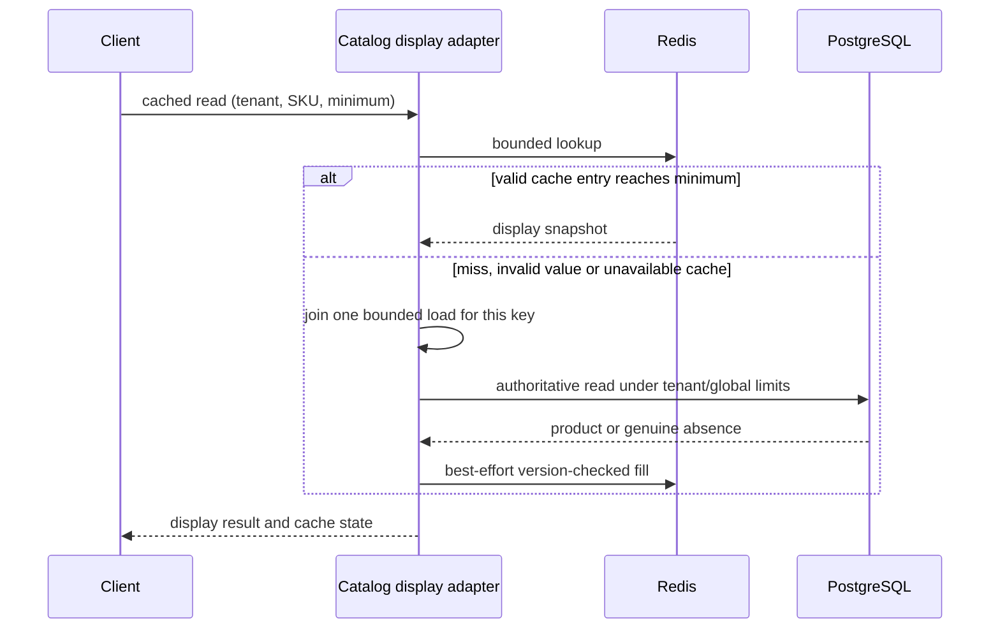

# Catalog caching, resilience and overload control

APP-09 adds an optional display cache around Catalog and finite resource policies at actual HTTP, database-read and provider seams. Price publication, immutable quotes and checkout amounts still come from PostgreSQL. The [scenario](../scenarios/cache-resilience.json) is one verified increment within the complete [baseline](plan/ddia-go-mega-project-plan.md).

Run from the repository root with Go 1.27+, Docker Compose and the local PostgreSQL test binding from `make configure`. Integration checks create and drop an isolated database and never silently skip missing services.

```sh
make up
make verify ID=APP-09
make up-resilience
make verify-resilience-live
make restore-default-cache
make down
```

`make verify ID=APP-09` runs the race suites, four new native PostgreSQL checks, three optional native Redis checks, coverage validation and the write-behind comparison. It starts only the dedicated `ddia-go-cache-test` Redis on loopback **16380**, then removes that test container and its disposable volume. Redis **7.4.2-alpine** is pinned by its Linux amd64 digest. `make down-redis-test` cleans an interrupted run.

The application Redis overlay uses loopback **16379** and the existing `ddia-go` API/worker/provider/PostgreSQL project. `make verify-resilience-live` stops only this project's Redis, publishes another real price, verifies authoritative and fallback reads and a quote, starts Redis, waits for cache hits, and compares the API container ID and start time. Cleanup starts Redis even after failure. `make restore-default-cache` recreates the API with the base memory-cache configuration and removes only that Redis container. `make down-resilience` stops the full development profile while retaining PostgreSQL data.

## Read and write contracts

| Operation | Behavior |
| --- | --- |
| `GET /v1/catalog/products/{sku}` or `?consistency=strong` | Authoritative database read; `X-Consistency: authoritative` |
| `GET /v1/catalog/products/{sku}?consistency=cached` | Opt-in display cache; `X-Consistency: bounded-stale` and `X-Cache` |
| Cached read with `&min_version=N` | An older positive or negative entry cannot satisfy the call; a fresh source read must reach N |
| `PUT /v1/catalog/products/{sku}` | Existing expected-version/idempotency transaction, followed by bounded best-effort invalidation |
| Quote creation and checkout | Existing authoritative reads and immutable server-owned prices; never a cached display price |

A minimum ahead of the current source returns 409; a missing source product returns 404. Invalid/duplicate consistency and minimum-version arguments return 400. The minimum is a caller-supplied monotonic-read hint, without a global session or linearizability promise. `X-Cache` is `hit`, `miss`, `negative`, `coalesced` or `fallback`. Default strong reads, GraphQL published readers and checkout continue to use their authoritative paths.

Each key hashes **tenant + separator + SKU**; each value also binds those identities, format, domain constraints and exact integer version. Unknown/trailing fields, oversized bodies and incompatible metadata fall back to the source. A 404 alone may become a negative record; timeouts, overload and source errors never become absence. Normal cache values are at most 2048 bytes.

The bounded memory LRU is the default (1024 entries in the API). Redis is advisory: no persistence, 32 MiB maxmemory, allkeys-LRU eviction, eight active client connections and no SDK retry loop. Redis Lua atomically compares a retained version floor and the previous body version before accepting a fill. Versions are compared as decimal strings, preserving **9,007,199,254,740,993** without Lua floating-point rounding. Native tests race sixteen writers and reject a stale fill after invalidation.



## Invalidation, freshness and comparisons

A successful non-replayed publish cancels the local old load and raises the backend floor. Migration **005** adds a small transactional `NOTIFY` trigger when the product head version increases. Each API owns one independent `LISTEN` connection, reconnects after failure, and applies valid tenant/SKU/version notifications. A rollback emits no notification; two actual listeners verify both boundaries. An ordered barrier makes the rollback check independent of a guessed sleep.

Notifications are **not a durable change log**. Listener disconnection, Redis eviction/restart and finite floor retention can lose invalidation history. The positive entry TTL is **750 ms**, negative TTL **100 ms**, each randomly shortened by up to **20%**. A body can already be older when its source load finishes: its cache-age TTL does not establish an absolute 750 ms freshness guarantee. Loads have a separate one-second bound; missed notifications, concurrent commits and cache replacement remain visible consistency limits. `min_version` or authoritative reads handle callers that require a known newer price. No stale-on-error extension is used. Redis loss cannot change a committed quote or authorize an old price for checkout.

The store decorator is a read-through boundary over a cache-aside backend. Optional validated modes provide executable comparisons:

- `ATLAS_CACHE_REFRESH_AHEAD=true`: a positive hit in its last 150 ms starts at most one admitted refresh per key and returns the existing snapshot immediately. Refreshes share the same finite group and shutdown owner; hits do not spawn waiter goroutines.
- `ATLAS_CACHE_WRITE_THROUGH=true`: after the authoritative commit and invalidation, best-effort priming writes the returned version. Cache failure preserves the committed business response. Replays cannot re-prime an obsolete saved response, and lower versions cannot overwrite higher retained versions.
- `make cache-demo`: the independent [write-behind lab](../labs/ch02/cache/comparison.go) acknowledges version 2 before flushing, loses it on a **modeled** volatile crash, and demonstrates reversed delivery leaving version 2 instead of 3. A version fence converges to 3 across all 24 delivery permutations of four writes. A full two-entry queue rejects before acknowledgment. The report makes no physical process/disk durability claim. This adapter is deliberately absent from the production authoritative path.

## Pattern mapping

| Pattern | Concrete implementation |
| --- | --- |
| P23 | Read-through Catalog decorator, cache-aside backend, negative records and optional bounded refresh-ahead |
| P24 | Committed-version write-through, transactional notification invalidation and independent write-behind loss/ordering comparison |
| P25 | Keyed coalescing, shortened randomized TTLs, finite key counts and per-tenant origin admission |
| P26 | Inherited deadlines, cancellation, safe retries, dependency-wide credits and jittered exponential backoff |
| P27 | Circuit epochs/probe, independent HTTP/dependency bulkheads, token buckets and admission |
| P28 | Finite waiting/body slots, load workers, owner cancellation and graceful drain |
| P46 | Backend adapter interface, store decorator, dependency strategy/classifier, factories and validated options |
| P48 | Owned coalescer goroutines and finite producer/worker/result pipelines in the load command |

These concrete examples leave each pattern's broader production and semantic audit in the baseline.

## Resource and retry budgets

| Boundary | Active / queued | Time and failure policy |
| --- | --- | --- |
| HTTP reads and writes, independently | 16 / 32 each | One inherited request budget, max 10 seconds; independent 2000 requests/s buckets, burst 512 |
| Source product reads, globally | 8 / 16 | At most 2 physical attempts; one-second total, 500 ms/attempt |
| Product reads per active tenant | 2 / 4 | Applied before global competition; at most 64 tenant registry entries, idle entries removed |
| Cache I/O | 8 / 16 | One logical attempt; 100 ms total, 80 ms/attempt |
| Provider HTTP | 8 / 16 | 1200 ms total, 400 ms/attempt; at most 3 safe attempts |
| Coalesced loads and refreshes | 64 active | One second per owned load; canceled/invalidated callbacks still count until they actually exit |

The published Inventory OpenAPI subset documents the new overload/body responses in version **1.2.0** and retains an identical lab copy. Ingress rejects rate exhaustion with **429**, queue/capacity exhaustion or drain with **503**, and waiting-budget expiry with **504**. Retriable admission responses include `Retry-After: 1`; callers must retain an existing mutation identity if they retry. Read and write body slots separately bound memory before reading up to 64 KiB. Reading a POST body to EOF before queueing lets HTTP/1 observe disconnects; a queued canceled call cannot reserve stock later. Health bypasses normal rate limits; readiness returns 503 during drain. Configured HTTP active+queued slots cannot exceed 1024 per workload. Existing body/domain/auth validation remains in the owning feature adapter.

The retry budget is shared by all calls using a dependency policy: lifetime additional attempts are at most **2 + floor(original attempts × 20 / 100)**. Actual physical calls can be fewer than granted retry credits when cancellation, circuit rejection or admission intervenes. Rejected admission mints no original credit. Policies use capped exponential backoff plus random jitter and one parent deadline. They retry only a read or explicitly idempotent operation classified as transient. Business absence, validation and provider 4xx (except 429) terminate. Cache SDK retries are disabled; EVALSHA's NOSCRIPT fallback is a separate Redis script-resolution exchange, not another business attempt.

A circuit opens after four consecutive failed attempts for 500 ms, permits one recovery probe, and ignores completions from an earlier breaker epoch. Parent cancellation does not mark the dependency broken. A probe canceled before doing work releases its probe ownership. Native tests show circuit recovery with the same client after a dependency returns.

Provider mutation retry ownership stays with the durable payment workflow by default, avoiding another automatic capture/close loop inside each durable step. Lookups use the bounded safe retry policy. An explicit `RetryMutations` comparison enables immediate retries against the simulator's durable intent fence; the native lost-response test verifies two HTTP attempts and exactly one SQL provider operation with the identical intent. Permanent-error and parent-cancellation tests verify termination and released permits. Real-provider idempotency and reconciliation policies remain provider-specific APP-05 work.

HTTP admission accepts `ATLAS_HTTP_{READ,WRITE}_{ACTIVE,QUEUED}`, `ATLAS_HTTP_RATE` and `ATLAS_HTTP_BURST`. Cache configuration uses `ATLAS_CACHE_BACKEND=memory|redis`, `ATLAS_CACHE_ADDRESS`, optional `ATLAS_CACHE_PASSWORD`, and the two boolean comparison flags. Invalid configuration fails startup. Redis itself is allowed to be unavailable at startup: the source remains usable under its own finite limits.

## Cancellation, drain and load observations

One caller leaving a coalesced load cannot cancel other waiters. When the last foreground waiter leaves, the group cancels its load and removes the route, but continues charging the active slot until the callback exits. Invalidation detaches/cancels an old generation; late completion cannot delete or satisfy its replacement. Group shutdown cancels refreshes and awaits callbacks. Source/circuit/HTTP permit releases are idempotent and protected across cancellation and panic paths.

SIGTERM closes new ingress admission, reports unready, rejects waiting calls and lets active HTTP handlers finish within the existing ten-second server drain. Cache listeners and load owners then stop before their database pool closes. The existing 100-request live stock check also records shed requests separately from stock conflicts, with one physical attempt per command and the same ten-success invariant. The native drain test holds an actual PostgreSQL row lock, cancels a queued POST, rejects excess work, serves a separate read lane, releases the lock and verifies exactly one committed reservation. Canceling a caller after a business commit does not roll back that commit; saved request identities still govern retry outcomes.

```sh
# Read an existing synthetic product with finite concurrency.
go run ./cmd/loadgen -sku YOUR-SKU -requests 128 -concurrency 32
# Or explicitly create one synthetic product, then read it.
go run ./cmd/loadgen -seed -requests 96 -concurrency 16
```

The command accepts only a loopback URL, at most 1000 reads and 64 workers, a 30-second owner deadline, bounded bodies and samples, and no automatic mutation retry. It records HTTP/cache result counts, observed concurrency and latency samples summarized as p50/p95/max. A 429/503 is an observed shed request; malformed responses, transport errors, unexpected statuses or zero successful reads fail the run. It loads private `.env` through the config parser without shell-sourcing credentials. Timings are finite local observations, not a throughput/SLO claim.

Reports are `artifacts/resilience-postgres.json`, `resilience-redis.json`, `cache-comparison.json`, `resilience-live.json` and `resilience-load.json`. CI retains native and live artifacts and restores the default cache before continuing its Kafka/Temporal regressions. Operational procedures are in the [runbook](runbooks/cache-and-overload.md); authority choices are in [ADR 0022](adr/0022-advisory-cache-and-bounded-dependencies.md).

Production multi-region invalidation, durable CDC, workload-derived sizing, distributed quotas, identity policy, SLO telemetry, deployments and a complete sub-concept audit remain in APP-09, C02-02, C07-03, C09-01, C13-04 and OPS work. This increment does not close any of those packages or remove any part of the 88-package book baseline.
