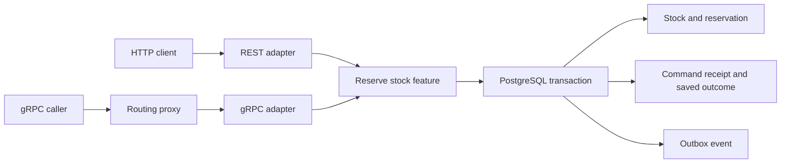

# REST, gRPC and uncertain outcomes

Inventory now exposes HTTP/JSON and generated gRPC adapters over the same `reservestock.Handler`. Both use the same tenant, operation, normalized command hash and PostgreSQL receipt. The transaction saves the reservation, stock revision, outbox event and original response together. A transport timeout does not undo a committed reservation.

Run from the repository root with Go 1.27.3, GNU Make, Linux amd64 and the local PostgreSQL test binding:

```sh
make up
make verify ID=C05-04
make up-routing
make verify-rpc-live
make down-routing
```

The scoped verification reproduces contracts, runs race/native database tests, builds actual executables and runs the isolated process drill. It creates and drops its own database through `ATLAS_TEST_DATABASE_URL`; it never silently skips a missing database. The drill starts its own HTTP server, two RPC processes and a routing process on dynamic loopback ports. Generated reports and registry snapshots remain in ignored `artifacts/rpc.json` and `artifacts/rpc-run-*`; executable hashes and source revision are in `artifacts/rpc-binaries/manifest.json`. Stop the ordinary development stack with `make down` when finished.

## One operation, two transports



| Contract | Implemented surface |
|---|---|
| [OpenAPI 3.1](../api/openapi/inventory/openapi.json) | `POST /v1/reservations`, reservation lookup, stock lookup/receipts and health. This is a named subset of Atlas's HTTP API. |
| Served specification | `GET /openapi/inventory.json`, compared byte-for-byte with the independent lab's generated copy. Actual receipt/reserve/stock/reservation values pass its JSON Schema components. |
| [Protobuf IDL](../contracts/proto/inventory/v1/inventory.proto) | `atlas.inventory.v1.Inventory/Reserve` and `GetReservation`, with checked-in Go messages, server interface and client. |
| [Feature](../internal/inventory/features/reservestock/handler.go) | Validates stock/warehouse/quantity/TTL, normalizes the legacy default warehouse and executes one owning-context transaction. |
| [Caller](../api/grpc/client/client.go) | Retries only reservation commands with a stable key and safe reservation reads; snapshots each request before retrying. |

REST carries the key in `Idempotency-Key`; gRPC carries it in `ReserveRequest.idempotency_key`. Keys contain 1..128 printable ASCII characters. Tenant identity comes from a development bearer credential. The shared authenticator creates actor, correlation, request and causation metadata on the server; an arbitrary tenant field cannot select another tenant. REST retains its existing behavior of ignoring `X-Tenant-ID`; gRPC rejects caller-supplied tenant metadata. Both reject server-owned actor/request/causation overrides and ambiguous bearer headers.

The default warehouse is represented by an omitted/empty value (or legacy REST JSON null); the explicit `default` alias normalizes identically. Business TTL is 0..3600 seconds, with zero or legacy REST JSON null selecting 900 seconds. TTL is the lifetime of a committed hold, separate from a request's timeout. Canceling a request cannot compensate an already committed hold; release/expiry remains an explicit business operation.

REST uses resources, methods, `Content-Type`, bearer authentication, `Location`, no-store cache policy, and informational stock `ETag`s. Conditional commands using `If-Match` are rejected. REST JSON emits int64 values as numbers: Go clients must decode exact integers, and JavaScript clients must account for values beyond `2^53`. gRPC preserves int64 values and represents expiry as Unix milliseconds; REST timestamps retain their native database precision. This is not an automatic ProtoJSON gateway.

## Deadlines, cancellation and retry ownership

| Boundary | Limit or behavior |
|---|---|
| REST request | Default 10 seconds; optional `X-Request-Timeout-Ms` accepts one integer from 1 through 10000. An earlier parent deadline wins. |
| gRPC backend and proxy | Each caps the incoming context at 3 seconds. grpc-go forwards the remaining budget and cancellation to downstream calls. |
| Published caller | At most three attempts, each capped at 750 ms, inside one total 3-second or earlier caller budget. Backoff is 15/30 ms plus up to 10 ms jitter. |
| Retryable status | `UNAVAILABLE` and `DEADLINE_EXCEEDED`, while the original budget remains; reservation retries reuse the exact key and snapshotted payload. |
| Permanent/business status | Invalid input/authentication, missing resources, insufficient stock, changed-key payload conflicts and concurrency conflicts are returned without automatic retry. |
| SQL cancellation | A live canceled request sends PostgreSQL `CancelRequest` after 25 ms; a 750 ms socket deadline is the fallback. |
| RPC database session | Statement limit 2500 ms, lock wait 1500 ms, idle transaction 3000 ms. These also bound abandoned SQL after process death. |
| HTTP database session | Statement limit 8000 ms, lock wait 7000 ms, idle transaction 9000 ms, beneath the 10-second request cap. |
| Wire/resource admission | RPC messages 64 KiB, header lists 16 KiB and 64 concurrent streams per connection; registry files 4096 bytes and at most 16 endpoints. |

SQL limits apply to API pools. Migrations and durable workers retain their own execution budgets. Statement limits bound individual queries, while the inherited context bounds the request. Inventory preserves the caller's cancellation/deadline error when SQL cancellation caused a failed operation. A successful commit remains a success internally even when cancellation races afterward; the client may still miss that response.

The [proxy](../internal/platform/routing/proxy.go) performs one forwarding attempt. The caller constructor disables service-config retries so independently configured layers do not multiply attempts. A transport can fail before sending, while the server is working, or after commit but before a response arrives. Only the first two can sometimes be established as having no effect; a timeout alone establishes none of them.

The drill deliberately suppresses a reply **after** observing a successful real backend reservation. The caller sees `DEADLINE_EXCEEDED`; the same-key retry returns the saved reservation. Independent SQL queries require exactly one receipt, reservation and outbox event for that command. A changed payload conflicts. A separate counterexample uses two distinct command IDs and produces two reservations even though routing is healthy: the network layer cannot infer one business intention from unrelated IDs.

## Discovery, balancing and mesh responsibilities

`atlas rpc` defaults to `127.0.0.1:18083`; `cmd/router` defaults to `127.0.0.1:18084`. The [Compose overlay](../deploy/compose/routing/compose.yaml) starts `rpc-left`, `rpc-right` and the proxy, exposing only the proxy on loopback. RPC pools label database sessions so the process drill can observe the exact backend lock wait before sending SIGKILL.

The proxy reads an operator-owned JSON registry, feeds a gRPC resolver, and uses round-robin balancing plus the standard streaming health service. Backends periodically check their database/migration readiness. `NOT_SERVING` endpoints are excluded; the proxy reports `NOT_SERVING` when no backend is ready. Business correctness remains with the service and its database.

```json
{"revision": 2, "endpoints": ["rpc-right:8083"]}
```

Updates are atomic file replacements in the mounted **directory**, polled every 200 ms. Revisions must increase when endpoints change. Invalid, conflicting or stale snapshots retain the last valid state. A higher-revision empty endpoint list withdraws all destinations; it is not treated as “keep the old list.” Restore both endpoints with another higher revision. The revision check is local to the running proxy; this file is not a consensus registry, heartbeat lease service or replicated control plane.

| Book mechanism | Concrete comparison or decision |
|---|---|
| Static IP/port | Direct loopback calls bootstrap the drill; killing that endpoint demonstrates the limitation of a fixed destination. |
| Hardware load balancer | Appliance deployment is an infrastructure choice; this repository demonstrates the routing/health role with software rather than emulating hardware. |
| Software load balancer | The real standalone Go proxy balances unary gRPC calls. HTTP/2 keeps connections open, so balancing occurs per RPC, not merely per TCP connection. |
| DNS | The public caller accepts `dns:///host:port`; live Compose verification bootstraps via `dns:///localhost:18084`, and container names resolve via Compose DNS. Cached answers may outlive moved processes. |
| Registry discovery | Versioned endpoint snapshots update live destinations without recompiling callers. The drill removes a killed process and selects its surviving peer. Automatic registration, heartbeat leases, locality/shard metadata and registry consensus remain separate backlog work. |
| Service mesh | The local proxy demonstrates forwarding, health, discovery and shared deadlines. A full client/server sidecar topology can add identity/TLS, traffic policy and telemetry. This exercise does not deploy Istio/Linkerd or claim a complete mesh control plane. |

Exercise: assign ownership of encryption, endpoint selection, retries, authorization, outbox publication and reservation uniqueness. A proxy can own transport encryption/selection; the application still owns credential-to-tenant policy, command identity and business invariants. Moving retries into a sidecar does not give it permission to invent a key or replay an arbitrary mutation.

The development listeners and Compose network use plaintext with development bearer keys. The published caller requires explicit transport credentials; production TLS/mTLS termination, credential rotation, registry authentication, distributed telemetry and rollout policies remain operational work in the full plan.

## Mixed versions and independently deployed services

The service owns a narrow business API rather than exposing arbitrary SQL or private aggregates. The gRPC and REST adapters stay outside feature/domain code. That encapsulation lets database migrations and internal implementations evolve without coordinated client changes.

The [frozen original IDL](../contracts/proto/inventory/legacy/inventory.proto) has the same protobuf message/service identities but fewer fields. The lab loads its descriptor into a private registry instead of registering incompatible copies globally. A baseline server fixture decodes this descriptor and delegates business work to the real backend; it is explicitly a contract adapter, not a claimed historical Atlas release.

Four actual HTTP/2 calls cover baseline/current clients against baseline/current server contracts. Common reservation fields survive. A baseline binary response relay preserves unknown current fields; rebuilding the same value through old-schema JSON loses them. An absent revision in an old reply is not evidence that a command was newly executed.

Current clients may call baseline servers using the common request shape. A new warehouse field is rejected by the old adapter before executing business work; silently treating it as the default warehouse would reserve the wrong inventory. Current servers likewise reject unknown request fields. Add optional request support on servers before clients use it, and tolerate unknown response fields. This follows the book's server-first deployment assumption: backward compatibility for old requests, forward compatibility for old readers of new responses.

For independently controlled external clients, support may need to persist much longer. Atlas chooses `/v1` resource URLs and `atlas.inventory.v1` service identity, additive field numbers and stable names. URL versions, `Accept` negotiation and per-client server-stored versions are alternative policies; no universal versioning policy is implied. An incompatible future contract needs explicit coexistence and retirement, not reused protobuf field numbers. Generated multilingual SDKs and cross-language conformance remain part of the original audit backlog.

Historical EJB/RMI, DCOM, CORBA and SOAP/WS-* illustrate language/platform coupling or complex interoperability promises. They are discussed as alternatives, not reimplemented as Go frameworks. The practical requirement is to expose remote uncertainty, byte encoding, variable latency and independently evolved types instead of pretending that an RPC is an ordinary in-process pointer call.

The [chapter mapping](chapters/ch05/rest-rpc-discovery.md), [decision](adr/0020-inventory-rpc-and-routing-boundaries.md), [runbook](runbooks/rpc-failures.md), [scenario](../scenarios/rpc-transport-failures.json) and [validation](VALIDATION.md) retain the evidence and limits. C05-04 remains in progress pending the full semantic, interoperability, scale and deployment audit; all 88 original work packages remain in scope.
