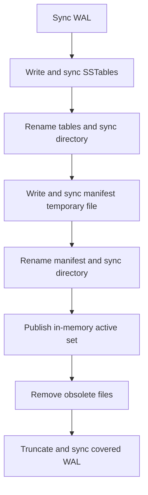

# Storage engine lab

The storage lab implements a persistent LSM key/value engine and compares it with an append-log configuration, the custom page-based B+ tree and the mature bbolt embedded engine. Every alternative runs the same synthetic warehouse snapshot workload: insert stock views, overwrite some versions, delete others, read points and tenant prefixes, then reopen. The application's authoritative Inventory, Ordering and financial data remain in PostgreSQL.

## Run

Go 1.27+ and a filesystem with advisory locks, atomic same-directory rename and directory fsync are required. Linux is the verified platform. These commands require no API, database, broker, Temporal server or credentials:

```sh
make verify-storage
make verify ID=C04-01
go run ./cmd/guide verify-storage
```

Each command runs the storage race tests and a repeatable comparison, then saves `artifacts/storage.json`. The test suite includes the map oracle, corruption checks, a power-loss filesystem model and real process kills. The ordinary `make test` includes all lab tests; `make verify` also generates the storage report.

`C04-01` through `C04-05` are implemented scoped verification bindings. The [index/trade-off verification](INDEXES.md) additionally requires the local PostgreSQL test binding for real plans. The [column/analytics verification](COLUMNSTORE.md) uses the Go compiler for its native predicate mode and requires no services. The [search verification](SEARCH.md) starts its own isolated PostgreSQL/pgvector test profile. The [data-model verification](MODELS.md) also binds `C03-01` and uses the local PostgreSQL test binding. The [property-graph verification](GRAPHS.md) binds `C03-03` and starts its own PostgreSQL/Neo4j profile. The [semantic-graph verification](SEMANTIC_GRAPHS.md) binds `C03-04` and starts its own PostgreSQL/Fuseki profile. The [GraphQL verification](GRAPHQL.md) binds `C03-05` and uses the local PostgreSQL test binding. Other plan IDs fail explicitly rather than running an unrelated broad check; their eventual interfaces remain in the original backlog.

For a report without rerunning tests:

```sh
make storage-demo
cd labs
go run ./cmd/lab lsm -rows 2048 -runs 3 -output ../artifacts/storage-large.json
```

The runner creates and removes only its own temporary database directories. With `-output`, those databases are temporary children beside the report. `-workdir` can select another parent filesystem; without either flag the runner uses system temp. It never removes the parent or adopts an existing database. The report identifies Linux filesystem type, including volatile `tmpfs`; fsync timing on tmpfs is not persistent-device latency. bbolt **1.4.3** is pinned in the independent lab module; production code does not import that module.

## Implemented mechanisms

| Mechanism | Implementation and visible evidence |
|---|---|
| Append log and memory index | Framed WAL plus a hash map; the append-log scenario stays below its flush threshold and reconstructs the map on reopen |
| WAL integrity | Version magic, bounded length, separate header/body CRC32C, operation kind and monotonic sequence |
| Memtable and immutable SSTables | Latest version per key in memory; sorted flush runs with immutable data and metadata |
| Sparse index | First key, offset and length per block; point reads and range starts seek to a candidate block |
| Bloom filter | Ten bits per key, seven stable probes; deletes are members too; checks/skips are counted |
| Version reconciliation | Highest record sequence wins, including when a newer file contains older versions |
| Size-tiered compaction | Merge a fanout of older runs in the same tier into a larger run, within explicit file limits |
| Leveled compaction | Merge overlapping target ranges into bounded files; levels above L0 have disjoint key ranges |
| Deletion | Retain tombstones during partial merges; remove them only in an explicit full-database compaction |
| Manifest recovery | Hashed, versioned active-file set; durable publication before obsolete-file removal or WAL reset |
| Writer coordination | One advisory directory lock; one in-process mutex serializes operations and compaction |
| Mature engine comparison | bbolt uses copy-on-write B+ tree transactions with sync enabled; the adapter copies values before releasing read transactions |

The current LSM has levels 0 through 3. The final level is a bounded terminal tier. Automatic compaction preserves tombstones; `Compact` flushes the memtable and rewrites the complete active data set. Table sizes, record counts, file counts and parser allocations have hard lab limits. The limits are explicit errors rather than unlimited resource growth.

## Durability contract

`lsm.Open(dir, Options{})` uses synchronous writes. A successful `Put` or `Delete` means its WAL frame was fsynced. `AsyncWrites` acknowledges a write before that fence; only a successful `Sync`, `Flush` or completed compaction establishes the corresponding durable prefix. Close releases resources and does not upgrade asynchronous writes to a durability promise. A process kill preserves the OS page cache, so it cannot by itself demonstrate power-loss behavior.

An I/O/failpoint error during a mutation returns `ErrRecovery` and poisons the handle. Close and reopen the same directory. The last operation may have persisted even though it returned an error. Earlier successful synchronous writes must survive. This API provides individual key operations, without multi-key transactions, compare-and-swap, MVCC or production Inventory invariants.

Flush follows this order:



Compaction uses the same file/manifest publication rules, keeping the WAL checkpoint unchanged. The first directory sync makes table names durable before a manifest can reference them. The second commits the active set before inputs can disappear. Reopening follows only that manifest, never whichever table has the newest name. Unreferenced temporary/obsolete tables are removed after successful recovery.

Only an incomplete final WAL frame is truncated. A complete frame with invalid checksums, an invalid sequence, a damaged manifest, a missing registered WAL or a missing/checksum-invalid active table fails with `ErrCorrupt`. The engine never falls back to old files to guess the latest state. A separate initialization marker in the manifest distinguishes an interrupted first open from a missing WAL in an established database.

## Read the report

`artifacts/storage.json` records Go/OS/architecture, filesystem type and block size, sync policy, row count, repetition count, raw write/read durations, write latency percentiles, live bytes, file bytes, state digests and reopening checks. LSM results include WAL/table/manifest bytes written, table data bytes read, Bloom checks/skips, block reads, flushes, compactions and instrumented sync calls. `block_reads` counts point-query candidate blocks; iterator data reads are counted in bytes. Counters reset on reopen. Full-file integrity verification is reported separately from query/merge data reads; directory-creation setup is outside those counters.

Use the raw repeated runs to see variance. The workload starts with fresh databases but warm processes and an uncontrolled OS cache. It does not evict caches, measure device I/O, identify physical SSD behavior, or establish a universal performance ranking. bbolt has different transaction and page-allocation behavior. The custom [B+ tree](BTREE.md) joins this comparison, with page invariants and free-page churn evidence. The separate [controlled trade-off runner](INDEXES.md) adds sorted/shuffled write orders, phase-specific amplification, repeated variance, index layouts and PostgreSQL plans. Actual cold-OS-cache/device trials and broader scale remain outstanding in C04-03.

The [chapter walkthrough](chapters/ch04/log-structured-storage.md), [recovery runbook](runbooks/storage-recovery.md), [decision](adr/0008-bounded-lsm-laboratory.md) and [validation](VALIDATION.md) explain the evidence and its limits. The lab is a working implementation; C04-01 remains in progress pending the full sub-concept audit, compression and broader format/scale stress work.
