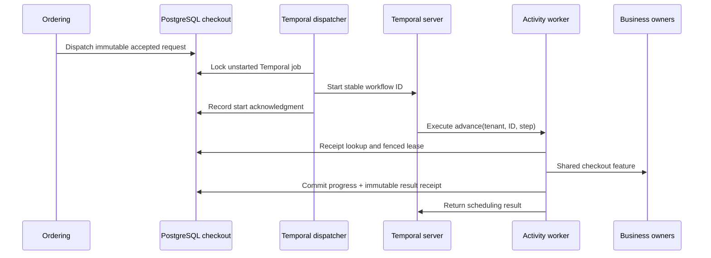

# Temporal checkout profile

The checkout can run under Temporal or the explicit PostgreSQL process manager. Both call `internal/checkout/features/advance`; Inventory, Payments and Ordering retain their existing ownership, stable operation IDs and confirmation/compensation fences. This profile adds durable scheduling, timers, signals, replay and workflow continuation. It does not make provider calls transactional.

## Run and verify

Stop the current profile before switching (`make down` or `make down-kafka`). Volumes are retained. Drain pending Temporal-owned purchases before stopping their runtime; changing the profile does not transfer accepted work to another engine.

```sh
make up-temporal
ATLAS_CHECKOUT_ENGINE=temporal make verify-checkout verify-checkout-recovery verify-fulfillment verify-operations
make verify-temporal
make integration-temporal
make down-temporal
```

The local UI is <http://127.0.0.1:8233>; gRPC binds to loopback port 7233. The server is the pinned Temporal CLI **1.4.1 development server**, with persistent SQLite in a named volume. The application uses Go SDK **1.37.0**. This is one development server, without replicated durability, TLS or production identity. The API and provider still bind to loopback ports 18081 and 18082.

`make integration-temporal` creates a separate server on ports 17233/18233, uses an isolated PostgreSQL child database and unique task queues, then removes its containers. Its volume retains only synthetic test history. Use `make down-temporal-test` after an interrupted test. `make verify-temporal` kills only this repository's `ddia-go` Temporal containers and restores them, so run it on a development stack.

Set `ATLAS_CHECKOUT_ENGINE=temporal` on host guide invocations that restart services. The Compose helper then retains the Temporal overlay when recreating the API. Runtime services use `ATLAS_TEMPORAL_ADDRESS` and optional `ATLAS_TEMPORAL_NAMESPACE` (default `default`). The profile uses a `passthrough:///temporal:7233` gRPC target so the service hostname survives proxy selection. Local service names remain in `NO_PROXY`. No external proxy or TLS settings are disabled.

## Ownership and handoffs

The server chooses the engine when Ordering first accepts a quote. That engine is persisted in the immutable checkout dispatch request and in `checkout.jobs.engine`; old rows default to `postgres`. Clients cannot choose the engine in the HTTP request. Business idempotency hashes exclude runtime configuration, so retrying an accepted checkout after a profile change returns its original response and owner.

The core worker continues projections, Fulfillment and PostgreSQL-owned jobs. Its checkout claim/checkpoint SQL excludes Temporal jobs. Temporal activities reject PostgreSQL jobs. A database trigger rejects changes to a job's engine or accepted request.



The workflow ID is `atlas-checkout/<tenant>/<checkout-UUID>` and task queue is `atlas-checkout-v1`. Start uses `RejectDuplicate`; a lost start response retries that ID, verifies the existing workflow type and acknowledges it. The database dispatcher never restarts terminal jobs. Temporal's duplicate-start retention is finite; permanent business deduplication comes from the retained checkout/resource records.

Each successful activity transition records its return value in `checkout.temporal_steps`, keyed by tenant, checkout and logical step. Updating the state, incrementing the step and inserting the immutable receipt happen in one PostgreSQL transaction. A retry after a lost completion returns the saved result. It cannot silently perform the next transition under the old step number.

An effect can still commit before its progress transaction. After a crash, the thirty-second job lease expires and the same step retries with the same reservation/payment IDs. Owner idempotency, provider reconciliation and close markers cover this gap. A replaced or expired lease cannot checkpoint. Activities have a ten-second execution timeout; infrastructure retries back off from one to five seconds. Business retries return a scheduling result and use a durable timer, retaining the same ordinal. Error diagnostics contain a generic code, not provider payloads.

## Durable controls, cancellation and replay

Pause/resume/retry and API cancellation first commit their authoritative database flags. A transactional trigger appends a wake intent. The dispatcher sends a coalescible `refresh` signal, then acknowledges the wake. A lost signal acknowledgment can duplicate the hint safely. Activities always read the flags; timer polling also guarantees another check when hints are delayed. Paused work does not take a business lease. Existing local control version, capability and audit rules still apply.

API cancellation preserves the first requesting metadata. Native Temporal cancellation switches to a disconnected workflow context and persists a cancellation flag through an activity before compensation. That branch identifies its executor as `worker:checkout`, without claiming the identity of a Temporal CLI operator. Cancellation during a pause waits for resume. Ordering's outcome fence still decides a race with confirmation; an already confirmed purchase stays confirmed. Native **termination** skips workflow cleanup and is not a compensation command.

Workflow/activity history contains identifiers, a global step ordinal, a cancellation flag and scheduling results. Operational requests, frozen quotes and payment method references remain in PostgreSQL. Workflows use SDK timers and channels, never database calls, wall-clock time, random numbers or HTTP. `GetVersion("checkout-loop", DefaultVersion, 1)` retains one-second timers for histories with no version marker; new runs use 500 milliseconds. Tests replay a real recorded v0 history through current code. Do not remove compatibility branches while histories needing them remain runnable.

After 64 activity turns the workflow continues as new, carrying the global ordinal and cancellation flag. This bounds each run's polling history while retained database receipts remain unique across runs. There is no arbitrary checkpoint-edit or completed-purchase restart operation. Repair of terminated/failed histories, production retention, worker deployment routing and replicated Temporal operation remain tracked work.

## Comparison

| Concern | PostgreSQL process manager | Temporal adapter |
|---|---|---|
| Schedule authority | Job deadlines and worker loop | Durable workflow history, timers and task queue |
| Business progress | Fenced job checkpoint | Same checkpoint plus immutable activity result receipt |
| Wake after a control | Database scheduling fields | Transactional wake intent and signal; timer fallback |
| Crash after resource effect | Stable IDs, reconciliation, lease expiry | The same owner rules plus activity retry/history replay |
| Code compatibility | Persisted phase/state schema | Phase/state schema and deterministic workflow history |
| Local operation | PostgreSQL and app workers | Adds a persistent Temporal server, dispatcher and SDK worker |

The [chapter walkthrough](chapters/ch05/durable-execution.md), [recovery runbook](runbooks/temporal-recovery.md), [decision](adr/0007-temporal-checkout-ownership.md) and [validation](VALIDATION.md) link the mechanisms to executable evidence. Full-book coverage remains the release gate.
