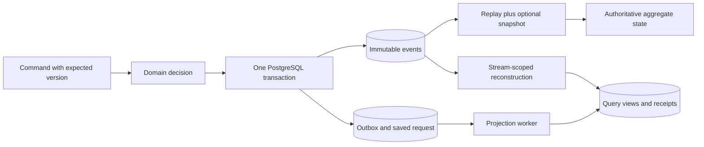

# Chapter 3: CQRS and event sourcing through Ordering

Related packages: APP-04, C03-06, C05-03, C12-04, C13-02. Source section: B03-026, “Event Sourcing and CQRS.” This page explains the implemented slice; the full packages remain in progress.

Inventory currently stores authoritative state in tables. Ordering makes immutable events authoritative. Placing an order emits `order.placed`; amendments emit `order.lines-replaced`; cancellation emits `order.cancelled`. Each stream has its own version, independent of all other orders.

Run the complete example:

```sh
make up
make demo-orders
make verify-orders
```

The verification places an order, repeats its key, submits 20 competing amendments with the same expected version, snapshots the winning state, cancels it, reconstructs its view, and reads history one event per page. Exactly one amendment succeeds. The resulting history has versions 1, 2 and 3, and the asynchronous projection matches authoritative replay.

Read these files in sequence:

1. `internal/ordering/domain/order.go`: pure decisions and deterministic event application. Decisions produce facts without mutating committed state.
2. `internal/ordering/features/`: placement/amendment/cancellation use cases with explicit request identity.
3. `internal/ordering/adapters/postgres/store.go`: head locking, expected versions, event append, outbox, saved response, snapshots and replay.
4. `internal/ordering/adapters/postgres/worker.go`: incremental view maintenance, receipt deduplication and stream-local coordination.
5. `tests/integration/ordering_test.go`: competing appends, atomic failure, legacy schemas, immutable history, snapshot fallback, keyset pagination, concurrent rebuild and unknown-schema quarantine.

The event append, stream head, outbox intent and saved request result commit together. If the response is lost, retry uses that saved result. A stale read model never validates a command: command handlers rehydrate the authoritative aggregate under its head lock.



Full replay and snapshot-plus-suffix use the same reducer. Legacy placement facts are decoded through an upcaster; snapshots are disposable acceleration. Unknown schemas stop processing rather than producing a plausible but incomplete state. A database trigger rejects ordinary historical update/delete operations.

The projection is another representation. Its worker atomically stores the state change, processed-event receipt and progress. Rebuild uses the same stream-local lock as consumers before touching outbox/view rows, then takes the source head barrier. This lock order prevents a consumer/rebuild cycle and gives a clear prefix for reconstruction. The integration suite also deletes the view, reconstructs it solely from events, and resumes live processing afterward.

Trade-offs: event history and request identity grow without automated retention in this increment; source commands serialize per order; a per-stream rebuild briefly blocks that order's appends. Catalog quotes and the first payment/stock process manager are now implemented in the [checkout walkthrough](../ch05/checkout-workflow.md). Full actor/correlation metadata, all-stream generation cutover and Kafka transport remain later work.
