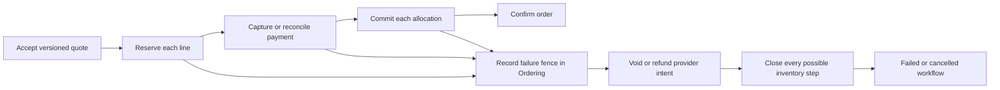

# Chapter 5: Durable checkout, unknown outcomes and compensation

Related packages: APP-05, APP-07, C09-04 and C13-05. This is the explicit persisted process-manager implementation; the [Temporal alternative](durable-execution.md) now schedules the same business feature.

Run:

```sh
make up
make demo-checkout
make verify-checkout
make verify-checkout-recovery
```

The demonstration publishes a price, receives stock, creates an order intent, requests a server-generated quote, and starts checkout. It then republishes a higher price. The accepted quote still controls the amount captured. The verification covers normal capture, lost capture response and decline. Recovery stops the provider, leaves a durable pending workflow, restarts its worker, and verifies eventual confirmation with one capture entry.



Each arrow is a durable checkpoint boundary. A worker claims one job with an incrementing token and a thirty-second lease, releases its database transaction, performs one step, then conditionally saves progress. It holds no workflow transaction open during provider HTTP calls. A replaced/expired lease cannot checkpoint stale progress.

That checkpoint rule alone does not prevent a paused worker's external calls. Resource owners enforce additional rules:

- Each inventory step has a stable ID derived from checkout/SKU. Closing it creates a permanent marker even if its reserve call has not arrived yet. Existing active holds are released; committed allocations are explicitly reversed.
- Each provider intent has a stable checkout payment ID and immutable amount/currency/method. Closing an unseen intent voids it; a later capture cannot charge it. Closing a captured intent refunds it once.
- Compensation first records a failed-order fact. Confirmation and failure compete on the source aggregate; whichever wins fences the contradictory later action. A compensator that discovers confirmation preserves that successful purchase.

This ordering handles a crash after an effect but before its checkpoint, including an unrecorded reserve or a capture whose response vanished. Compensation visits every original line using its stable step ID; it does not rely on an incomplete in-memory list of completed actions.

Read the implementation in this order:

1. `contracts/`: published interfaces/DTOs across context boundaries.
2. `internal/catalog/`: immutable price versions, snapshot quote arithmetic and tenant scope.
3. `internal/ordering/domain/checkout.go` and its PostgreSQL checkout facade: accepted pricing, source confirmation/failure fences and transactional dispatch intent.
4. `internal/checkout/features/advance/handler.go`: orchestration using only published business contracts.
5. `internal/checkout/adapters/postgres/store.go`: job identity, claim tokens, leases, retries and cancellation.
6. `internal/inventory/adapters/postgres/workflow.go`: stable operation IDs and resource-close markers.
7. `internal/payments/adapters/`: provider boundary, unknown-outcome reconciliation and immutable balanced transfers.
8. `tests/integration/commerce_test.go`: redelivery, failed allocation, refund-response loss, stale owner and journal integrity scenarios.

The source outbox and workflow inbox are separate transactions. If workflow creation commits but dispatch acknowledgment fails, redelivery must find the same immutable request and one existing job. Provider operations, local financial entries and order outcomes also commit separately. These are idempotency, reconciliation and compensation guarantees, not global ACID rollback.

Trade-offs: a provider outage can keep a workflow pending; leases may delay recovery after a crash; expired holds can require a later refund; compensation can itself retry. The current ledger has two legs per transfer and one full refund per payment. Warehouse sourcing, Fulfillment, audited controls and the Temporal alternative are now implemented in later increments. Single-SKU warehouse splits, broader recovery/repair, authorization/webhooks and a real provider remain tracked work.
