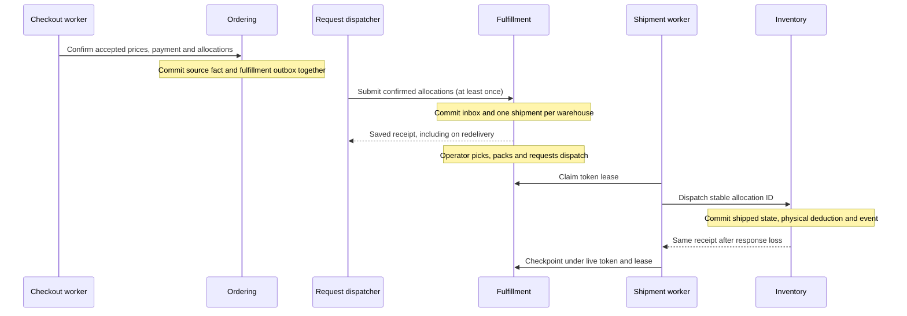

# Durable handoff from checkout to shipment

Related packages: APP-02, APP-03, APP-06, APP-07, C05-03, C09-04 and C13-05. This slice extends the [checkout process manager](checkout-workflow.md) with warehouse-aware Inventory and a sixth private context, Fulfillment.

The source confirmation fence is the ownership boundary. A checkout worker that wakes after confirmation preserves that result. Fulfillment never compensates payment merely because handoff is slow. If a multi-line shipment is partly handed off, it remains `dispatching` with an explicit progress count until the remaining lines finish. A return or post-confirmation cancellation needs its own business workflow.

Read the code in this order:

1. [Published request](../../../contracts/fulfillment/fulfillment.go) and [Ordering enqueue/dispatcher](../../../internal/ordering/adapters/postgres/fulfillment.go): source atomicity and acknowledge-after-sink-commit.
2. [Shipment aggregate](../../../internal/fulfillment/domain/shipment.go): lifecycle, defensive copies and bounded validation without infrastructure imports.
3. [Fulfillment store](../../../internal/fulfillment/adapters/postgres/store.go): local inbox, warehouse grouping, immutable identities/history and token leases.
4. [Dispatch slice](../../../internal/fulfillment/features/dispatch/handler.go) and [Inventory handoff](../../../internal/inventory/adapters/postgres/shipping.go): validate receipts and deduplicate the actual stock effect.
5. [Integration counterexamples](../../../tests/integration/fulfillment_test.go): failed source transaction, lost acknowledgment, unknown physical outcome, expired lease, stale worker, concurrent operators and resource closure.

Warehouse migration assigns existing balances and events to `default`. Old facts and saved responses omit the new optional field and retain their meaning. Existing confirmed order facts receive durable Fulfillment requests through backfill; this creates ready work only and performs no physical handoff. Existing snapshots remain readable because Order state did not acquire a required field. New confirmation proofs add an optional warehouse to each allocation. A coordinated API/worker upgrade is required because the old projection binary uses the earlier two-column key; this is not evidence of a full mixed-version rollout protocol.

The book's reliability argument appears at three different boundaries: an outbox prevents losing a request after source commit, an inbox prevents duplicate local construction, and an idempotent Inventory transition prevents duplicate physical deductions after an uncertain result. Token leases alone protect only the checkpoint. The integration test deliberately commits the physical effect, discards the checkpoint, expires its lease, then retries through another worker and rejects the old worker's save.

The model chooses availability at one location per SKU line. Location versions and projection quarantine are independent; a hot SKU at east does not serialize west's ordinary commands. The sourcing policy remains a simple greedy policy, with no cross-location stock transfer, routing optimizer or same-SKU split. Those extensions require explicit contracts and further failure tests.
