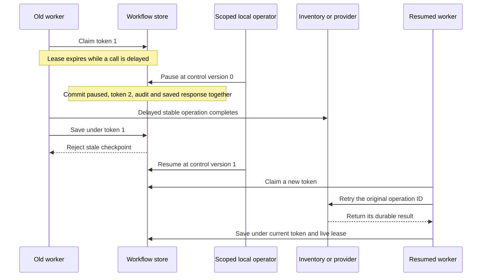

# Leases, lineage and operator recovery

Related packages: APP-04, APP-07, APP-08, C09-04 and C13-05. This slice extends the existing resource fences and durable checkpoints. It does not implement a distributed consensus service or a general workflow debugger.

The worker's token protects a local checkpoint. A separate resource intent protects the actual stock/payment effect. Operator controls use the same distinction: a pause can fence an expired token, while an old external call can still complete. A later resume must recover that original result rather than create another operation.

Read the implementation in this order:

1. [Published metadata](../../../contracts/envelope/metadata.go): schema versions, executor/initiator separation and worker resumption.
2. [Authentication middleware](../../../internal/platform/auth/tenant.go): credential-bound tenant actor, server-owned request ID and bounded correlation input.
3. [Operator capability](../../../internal/platform/operator/scope.go): in-process tenant scope independent of diagnostic actor labels.
4. [Scheduling primitive](../../../internal/platform/workcontrol/store.go): lock, post-lock clock check, expected control version, token fencing, immutable audit and saved response.
5. Owner adapters in [Checkout](../../../internal/checkout/adapters/postgres/operations.go) and [Fulfillment](../../../internal/fulfillment/adapters/postgres/operations.go): explicit terminal/retry policies, with no private cross-context imports.
6. [Failure tests](../../../tests/integration/operations_test.go): delayed effects after pause, unknown stock outcomes, operator races, audit rollback, scope forgery and lineage after provider response loss.

The shared scheduling helper writes only the owner-selected table's control/lease/scheduling fields. Each owner supplies its policy and opts into the primitive. It does not deserialize or modify the business checkpoint. This keeps a repair tool from silently becoming another authority for order/payment outcomes.

Metadata is also independent of business authority. An initiating request may be `tenant-key:acme`; confirmation is performed by `worker:checkout` and still carries the accepted request's origin. Fulfillment begins with a confirmation-event cause, then physical handoff follows its accepted dispatch-command branch. Operator audit has its own request/correlation and a resource snapshot linking it to the original workflow. No timestamp comparison invents causality between unrelated streams.

Legacy envelopes remain explicitly unknown. New envelopes are checked in Go and in PostgreSQL; immutable source/history and origin guards prevent ordinary metadata rewrites. Source reducers ignore these columns, so adopting provenance does not change event replay or canonical snapshot hashes. These guards do not establish security against a privileged database administrator, a production identity system, or a cross-store lineage auditor.
