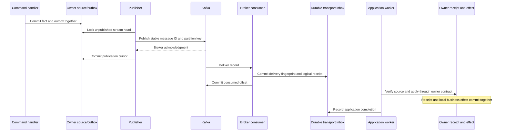

# Reliable delivery across PostgreSQL and Kafka

Related packages: APP-06, C08-08, C12-01, C12-02 and C13-05. This slice supplies a real broker transport for the shared application. The planned segmented-log broker, full Kafka operations lab and streaming operators remain separate implementations.

| Failure boundary | Durable evidence and recovery |
|---|---|
| Source command rolls back | No accepted fact or outbox work |
| Source commits before publication | Pending outbox head remains |
| Kafka accepts before acknowledgment/publication checkpoint | Source retries; physical duplicate can share the original logical ID |
| Staging transaction fails | No offset commit; a fresh consumer session replays from committed progress |
| Staging commits before offset acknowledgment | Kafka redelivers; transport delivery/logical receipt is recognized |
| Owner effect commits before transport completion marker | Handler repeats; owner inbox/projection receipt prevents another effect |
| Handler lacks a schema | Stream head retries then quarantines; unrelated staged streams continue |
| Same identity arrives with changed data | Preserve original evidence, record conflict and fence its stream |

Read the implementation in this order:

1. [Wire contract](../../../contracts/messaging/message.go): scoped identity, bounded schema and fixed partition mapping.
2. [Inventory source/receiver](../../../internal/inventory/adapters/postgres/broker.go) and [Ordering source/receiver](../../../internal/ordering/adapters/postgres/broker.go): independent publication cursor, predecessor checks, source validation and existing owner transactions.
3. [Kafka client](../../../internal/platform/messaging/kafka/client.go): explicit partitions, broker acknowledgments, manual offset commit, rebalance boundary and restart on staging/commit failure.
4. [Durable transport inbox](../../../internal/platform/messaging/postgres/inbox.go): raw receipts, immutable message identity, per-stream scheduling, conflict handling and audited retry.
5. [Composition root](../../../cmd/atlas/broker.go): routes published contracts while keeping private context imports out of other contexts.
6. [Database counterexamples](../../../tests/integration/messaging_test.go), [real broker tests](../../../tests/integration/kafka_test.go), and [live drill](../../../cmd/guide/kafka.go).

The real-broker tests create two physical records for one source event after an injected post-acknowledgment failure, then inject failure after durable staging but before offset commit. They verify redelivery and one owner effect. Another test observes a stable two-member consumer group, removes a member, publishes more work and verifies the full projection prefix. A third fails staging before a durable receipt and checks that the record is replayed. These use a dedicated Kafka instance and disposable database, rather than treating a fake publisher as broker evidence.

The live drill stops consumption while publication continues, then stops the broker and kills the publisher after new source work commits. Recovery uses retained broker/DB volumes. It also submits duplicate, malformed and conflicting synthetic records and recovers the retained original through the actual operator CLI. Per-stream isolation, locked predecessor behavior, local-profile fallback and post-owner-commit replay have separate database tests.

Broker acknowledgment, durable receipt and business completion are three distinct observations. The protocol provides at-least-once handler invocation with atomic owner receipts and resource idempotency where needed. It does not make an external payment call part of a Kafka transaction or establish a globally ordered history from unrelated offsets.
