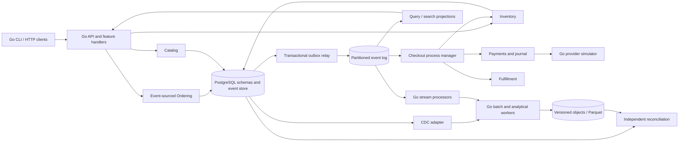

# DDIA Go Mega Project — End-to-End Implementation Plan

**Status:** design and implementation plan; application code has not been built in this task.
**Prepared:** 9 November 2026.
**Source:** *Designing Data-Intensive Applications*, second edition, Martin Kleppmann and Chris Riccomini, February 2026.
**User requirements:** all book concepts; a cohesive mega project in Go; domain-driven design; vertical slice architecture; CQRS and event sourcing; equal emphasis on a practical learning guide and production engineering.

Build **Atlas**, a multi-tenant order, inventory, payment, and fulfillment platform, together with a complete data-systems laboratory inside the same repository. The platform supplies real business invariants and continuous workflows. The laboratory supplies alternative implementations, failure demonstrations, and comparisons for concepts that cannot sensibly coexist in one deployed architecture.

**Full scope is mandatory.** A small first release is a checkpoint, not the final deliverable. Profiles control which components run on a developer's machine; they do not remove concepts from the implementation commitment. Every applicable algorithm or pattern gets working code or a runnable integration/model with clearly stated boundaries. Architectural, legal, and societal concepts get worked decisions and observable exercises, with implemented controls where applicable.

The initial inventory contains **14 chapters, 476 substantive section/subsection headings, 61 glossary terms, and 4,215 indexed chapter occurrences**. The plan organizes these into **88 work packages** and a separate **48-entry backend pattern catalog**. These counts establish traceability, not a claim that implementation is already complete. The final semantic audit must also catch concepts embedded in prose, figures, and examples.

Start with this document, then use:

- [Implementation backlog and acceptance criteria](implementation-backlog.md).
- [Source verification and coverage rules](source-and-coverage-audit.md).
- [Book section coverage](book-section-coverage.csv), [glossary coverage](glossary-coverage.csv), and [index traceability](book-index-traceability.csv).
- [Backend pattern catalog](backend-pattern-catalog.csv) and [machine-readable work packages](work-packages.json).

## 1. Completion means executable understanding

The repository must let a reader move in either direction: **book concept → explanation → code → scenario → evidence**, or **production problem → implementation → failure test → underlying concept**.

Every distinct concept must have:

1. A stable concept ID, source locator, named owner package, and original explanation.
2. A concrete implementation, integration experiment, finite model, or worked decision appropriate to the concept.
3. A runnable entry point using the shared fixtures and guide tooling.
4. Assertions about the outcome, including failure/recovery behavior when relevant.
5. An explicit statement of assumptions, limitations, and the circumstances in which to choose another approach.
6. A link to its place in the Atlas workflow or a precise explanation of the alternative it demonstrates.

For example, replication includes a real primary/standby configuration, Go single-leader/multi-leader/leaderless models, lag and conflict experiments, and recovery measurements. Adding a database replica without explaining or testing the guarantees does not complete that topic. Likewise, including a Kafka client does not complete stream processing: time, joins, replay, checkpoints, retention, and sink semantics are separate obligations.

The project implements concepts represented by named products. It does not recreate every commercial database mentioned in the book. A finite Raft, B+ tree, Datalog, or 3PC laboratory must be complete for its declared supported model and reject unsupported cases; it must not present itself as a general replacement for mature infrastructure. No production target may import educational storage or consensus implementations.

Book coverage and additional engineering patterns are tracked separately. DDD, architecture organization, deployment practices, and Go design patterns augment the book; they are not all attributed to its authors. The pattern catalog is a concrete baseline, not a claim to enumerate every pattern in software engineering. Newly discovered book concepts must extend the tracked scope.

## 2. One domain that makes the concepts necessary

**Working name:** Atlas. **Reference domain:** a marketplace with multiple tenants, warehouses, stock reservations, checkout, a simulated payment provider, shipment, search, and analytics. Both are provisional naming/domain choices, not unresolved blockers.

The main journey is:

`create tenant → publish products → receive stock → place order → reserve inventory → authorize/capture payment → commit allocation → confirm order → fulfill shipment → update search/analytics → reconcile → cancel/refund where allowed`

The project also supports inventory changes, failed payments, duplicate webhooks, expired reservations, returns, privacy requests, and offline warehouse notes. A separate social-network-shaped fixture preserves the book's fan-out case study while reusing the same timeline machinery for order activity.

### Bounded contexts and ownership

| Context | Owns | Principal rules | Modeling choice |
|---|---|---|---|
| Identity and tenancy | Tenant membership, roles, authorization integration | Every resource belongs to a tenant; permissions follow authenticated identity | Supporting context; OIDC adapter plus explicit development issuer |
| Catalog | Products, descriptive documents, price versions | Orders retain the accepted price/version; later catalog changes do not rewrite purchases | Relational state plus JSONB for suitable attributes |
| Inventory | Stock by tenant/SKU/warehouse, reservations, allocations | Reserved and allocated amounts cannot exceed on-hand stock; state transitions are idempotent | Transactional aggregates; conditional writes and database constraints |
| Ordering | Order intent and lifecycle, checkout process state | Valid transitions; optimistic stream concurrency; confirmation requires known payment and stock outcomes | Event-sourced aggregate; CQRS read models |
| Payments | Provider interaction, payment lifecycle, immutable journal | Balanced postings per currency; no duplicate capture/refund effects; reconciliation of uncertainty | State machine plus immutable double-entry entries |
| Fulfillment | Shipment requests, dispatch, returns | One active execution per shipment command; cancellation respects shipment state | Transactional aggregate and durable worker |
| Search and customer views | Authorized derived query models | Rebuildable; freshness visible; never authoritative for stock/payment decisions | Event/CDC-fed projections |
| Analytics | Facts, dimensions, feature datasets, reports | Versioned inputs and transformations; auditable lineage | Batch and stream derivations |
| Privacy | Consent, purpose policies, exports, retention and erasure progress | Authorization and deletion propagate to derived copies and replay | Durable lifecycle workflow |

Catalog, Inventory, Ordering, Payments, and Fulfillment own separate schemas and migrations. Initially they share a PostgreSQL server, while application rules forbid reading another context's private tables or opening cross-context business transactions. Integration happens through published requests/events. Query projections can intentionally compose context data in schemas they own.

The small shared vocabulary contains identity primitives and carefully chosen value representations; it must not become a shared business-model package. Money uses integer minor units with an explicit currency and checked arithmetic. Cross-currency exchange is outside the reference business domain; the journal still enforces balance separately per currency.

### Invariants that anchor the entire project

- `on_hand >= 0`, `reserved >= 0`, `allocated >= 0`, and `reserved + allocated <= on_hand`, with shipment/return transitions updating the corresponding quantities atomically.
- One expected stream version admits at most one competing order transition.
- A confirmed order has recorded successful inventory commitment and captured payment for the required amount; compensation and cancellation are explicit later transitions.
- Journal debits equal credits for each transaction and currency. Historical corrections use compensating postings.
- Repeated requests, messages, or webhooks cannot produce duplicate logical financial effects within the documented identity and retention contract.
- Queries, commands, exports, event subscriptions, and worker processing cannot cross tenant boundaries without explicit authorization.
- A rebuilt projection matches its authoritative inputs at a documented consistency boundary.
- Losing a cache, projection, worker, or broker connection must not silently corrupt authoritative business state.

The workflow cannot make PostgreSQL and a remote provider commit atomically. The invariant is preserved by durable intermediate states, reconciliation, and compensation—not by labeling a saga a distributed ACID transaction.

## 3. Architecture and repository organization

Use a **modular monolith first**, with separate API and worker processes as needed. Feature handlers implement vertical slices inside bounded contexts. Ports/adapters isolate external I/O. Later, an extraction profile moves Inventory or Fulfillment into another process while keeping the same business contracts and acceptance suite.

CQRS separates command decisions from query representations. Event sourcing is the authoritative model for Ordering, where history and replay are useful. Inventory and payment state use appropriate transactional models. The repository demonstrates these alternatives intentionally; event sourcing is not imposed on every table.



The boxes indicate ownership and dataflow, not a requirement to deploy each box as a microservice. The core profile uses PostgreSQL-backed dispatch; the events profile uses Kafka. Both implement the same event delivery contract. Temporal is an alternative checkout orchestrator with separate ownership, not a second orchestrator running the same saga concurrently.

### Planned tree

```text
ddia-go/
├── README.md
├── go.mod / go.sum                  # application module
├── go.work                         # application + independent lab module
├── Makefile
├── cmd/
│   ├── api/                        # HTTP composition root
│   ├── worker/                     # sagas, outbox, projections
│   ├── guide/                      # scenario runner / coverage / environment doctor
│   ├── admin/                      # migration, rebuild, reconcile; guarded operations
│   ├── loadgen/                    # Go open-loop load generator
│   ├── batch/                      # bounded analytical jobs
│   ├── audit/                      # independent integrity verification
│   ├── provider-sim/               # deterministic payment/provider failures
│   └── offline-client/             # local-first and stream-resume scenarios
├── internal/
│   ├── catalog/
│   ├── inventory/
│   ├── ordering/
│   │   ├── domain/                 # aggregates, value objects, events, policies
│   │   ├── features/
│   │   │   ├── placeorder/          # input, handler, ports, validation, tests
│   │   │   ├── cancelorder/
│   │   │   ├── getorder/
│   │   │   └── checkout/
│   │   ├── adapters/               # event store, SQL queries, transports
│   │   ├── workflows/temporal/
│   │   └── module.go               # explicit wiring
│   ├── payments/
│   ├── fulfillment/
│   ├── projections/
│   ├── analytics/
│   ├── privacy/
│   └── platform/                   # config, telemetry, auth, transactions, I/O utilities
├── api/{openapi,graphql}/
├── contracts/{events,proto,avro}/   # published schemas and compatibility fixtures
├── migrations/<context>/
├── labs/
│   ├── go.mod / go.sum             # distinct dependency surface and build target
│   ├── cmd/lab/
│   ├── internal/{sim,fixtures,oracle}/
│   └── ch01/ ... ch14/             # complete implementations and comparative experiments
├── scenarios/                      # domain workflows, failure schedules, expected invariants
├── fixtures/                       # versioned synthetic inputs shared across modes
├── tests/{integration,contracts,e2e,recovery}/
├── benchmarks/
├── docs/
│   ├── chapters/ch01/ ... ch14/
│   ├── patterns/
│   ├── domain/
│   ├── adr/
│   ├── coverage/
│   ├── runbooks/
│   └── governance/
├── deploy/{compose,helm,terraform/aws}/
├── .github/workflows/
└── artifacts/                      # generated evidence, excluded from source unless curated
```

Each context follows the Ordering structure only as far as its complexity warrants. A read handler can use a dedicated SQL query adapter without hydrating an aggregate. A command handler owns its transaction boundary and invokes domain behavior. There is no global generic repository, mandatory mediator framework, or reflection-based dependency-injection container.

The application and lab modules build independently. Production CI uses the application module with workspace overrides disabled where appropriate, and architecture checks reject any production import of `labs`. Tests ensure one context cannot import another context's private persistence/domain packages; Go's repository-wide `internal` rule alone cannot enforce these boundaries.

## 4. Concrete application contracts

### Event store and event envelope

The event store includes tenant ID, stream ID, stream version, immutable event ID, event type, payload schema version, payload, recorded time, correlation ID, causation ID, and relevant actor reference. Database uniqueness enforces `(tenant_id, stream_id, stream_version)` and event identity. A command appends only after validation against the authoritative stream state and expected version.

An event timestamp describes time; it is not a global ordering mechanism. The core order is per stream. An event envelope carries enough version/causal information for consumers to detect gaps and understand dependencies. A PostgreSQL sequence or timestamp must never become an undocumented global commit watermark.

Ordering command handling atomically commits event append, required local process state, outbox records, and request deduplication result. Snapshot records include aggregate version, snapshot schema version, and integrity metadata. A snapshot is a replay optimization: missing, old, or invalid snapshots cause replay from supported history, not a new source of truth.

### Reliable publication and consumption

The relay publishes at least once. Publishing leases and broker acknowledgments cannot eliminate the crash window after broker acceptance and before marking the outbox row delivered. Therefore consumers must tolerate duplicates.

Partition by tenant plus aggregate/stream identity. Multiple relay workers must preserve per-stream version order: use per-stream ownership/leases and next-version tracking, or an equivalent proven protocol. A blanket `SKIP LOCKED` query over arbitrary outbox rows does not establish this order. Consumers enforce sequence/version checks and either buffer within bounds or fetch missing events from the authoritative source.

An inbox unique key includes consumer identity, tenant, and event identity. Insert the inbox record, apply the local effect, advance the consumer's durable progress, and commit in one database transaction where these records share that database. Acknowledge the broker afterward. For nontransactional external effects, use a provider idempotency key and a durable reconciliation state.

Quarantine records preserve original identity and cause. An ordering-sensitive poison event blocks its stream until repaired or explicitly resolved; routing it to a dead-letter queue and continuing as if it succeeded is invalid. Deduplication retention must cover retry, replay, archive, and business reconciliation horizons. Financial identity records may need a much longer lifetime than broker retention.

### Checkout workflow

1. Validate command identity, tenant, accepted price/version, and order contents; persist `OrderPlaced` and a durable checkout instance.
2. Reserve inventory using an idempotent reservation command and explicit expiry/version.
3. Authorize and capture with the Go provider adapter. Persist step keys and distinguish success, permanent failure, and unknown outcome.
4. Commit the inventory reservation conditionally. If it expired or was canceled before commitment, reconcile/void/refund the payment as appropriate.
5. Confirm the order only when captured payment and committed inventory outcomes are recorded. Then request fulfillment through a durable command/event.
6. On failure, run idempotent compensation: release stock, void authorization, refund capture, or open a recoverable/manual case. Record deadlines, ownership, retry budget, and resolution history.

The precise transition table is finalized in APP-07 before coding, including cancellation versus shipping, partial stock availability, reservation expiry during provider uncertainty, duplicate callbacks, and crash-after-commit. No external payment is retried with a new key merely because the previous response was lost.

The PostgreSQL process manager and Temporal implementation must pass the same business outcome suite. Workflow replay must not execute provider side effects directly: those belong to idempotent activities/adapters. Payment journal reconstruction and query projection replay never send a payment, shipment, or notification again.

### Query consistency and rebuilds

Each query endpoint declares one of: authoritative read, snapshot read, or eventually updated projection. Mutations return an aggregate version or freshness token. A follow-up query may wait for that token up to a bounded deadline, read an approved authoritative path, or return an explicit pending state.

Projection generation `v2` builds alongside `v1`, catches up through a well-defined log/snapshot boundary, passes independent reconciliation, and becomes the read target through an atomic generation switch. The implementation must handle events whose database-generated IDs were allocated in one order but committed in another. Acceptable designs include CDC snapshot/LSN coordination or a per-stream replay/catch-up scheme with a brief final append barrier. Reading `MAX(id)` and ignoring all smaller IDs thereafter is not acceptable.

Rebuilds record their input boundary, transformation version, checksums, status, and cutover/rollback action. Live readers stay on a complete generation. Archives and current logs have a documented continuity check; missing history fails visibly.

### Tenancy and API behavior

Every key and uniqueness decision includes its tenant scope. Derive tenant identity from authenticated authorization context, not an unchecked request-body field. PostgreSQL row-level security can provide defense in depth when session/transaction tenant state is correctly set and reset across pooled connections; test background jobs and pooled-connection reuse explicitly.

The API includes stable error codes, OpenAPI contracts, bounded bodies, timeouts, conditional writes/ETags where useful, keyset pagination, and explicit idempotency behavior. Scope an idempotency key to tenant, actor/client, operation, and key; compare a normalized request hash. Store the original outcome. Same key/different semantics is a conflict, not another operation.

SSE/WebSocket consumers and exports enforce authorization throughout their lifecycle, including revocation. A development identity issuer is labeled and isolated; production adapters use OIDC and configured verification rather than homegrown password infrastructure.

## 5. Technology choices and runtime profiles

All application services, workers, algorithms written for the project, load generators, clients, test harnesses, and operational CLIs use **Go**. SQL, schema definitions, declarative deployment files, documentation, and an optional formal specification are supporting artifacts. Existing databases, brokers, and workflow engines remain external dependencies; the project does not rewrite their servers merely to keep the implementation language uniform.

| Capability | Planned choice | Purpose |
|---|---|---|
| Go toolchain | Supported stable version selected and pinned at kickoff | Exact toolchain in CI; no floating tool versions |
| HTTP | `net/http` with a small router if needed | Explicit request lifecycle and minimal framework coupling |
| Persistence | PostgreSQL, `pgx`, `sqlc`, a pinned migration tool | Transparent SQL, real transactions, owned migrations |
| Event transport | PostgreSQL dispatcher for core; Apache Kafka/KRaft with `franz-go` for events | Shared contract; broker-specific guarantees tested |
| Cache | In-process baseline and Redis adapter | Cache/resilience comparisons and hot-key experiments |
| Workflows | Explicit persisted Go process manager and Temporal Go SDK | Same workflow, two complete execution mechanisms |
| Encodings | JSON/XML/gob/MessagePack/Protobuf/Avro | Compatibility matrices and archival evolution |
| Graph/RDF | Neo4j/Cypher and Apache Jena Fuseki/SPARQL profiles, Go clients | Real query-language comparisons alongside Go models |
| Search | PostgreSQL FTS, pgvector profile, Go indexing labs | Exact/approximate/text/multidimensional comparisons |
| Objects | Go deterministic object-store port; local S3-compatible service; AWS S3 contract adapter | Immutable files, manifests, snapshots, Parquet, restore |
| Analytics | Go operators, Arrow/Parquet libraries where appropriate, optional Gonum | DataFrames/arrays, batch/stream algorithms and synthetic ML |
| Coordination | etcd Go client; separate educational Raft implementation | Mature coordination and transparent algorithm study |
| Observability | OpenTelemetry, Prometheus, Grafana, a compatible trace backend | Metrics/traces/log correlation and operational evidence |
| Testing | Go test/race/fuzz/bench, property checks, container integration, fault proxy | Real-system behavior plus repeatable protocol models |
| Deployment | Docker Compose, Helm for Kubernetes, Terraform AWS reference | Local reproducibility and one concrete cloud deployment example |

Freeze exact versions, container digests, licenses, architecture support, and library maintenance status in M00. The local S3-compatible service must pass the actual conditional-write contract required by the object-store lab; do not assume every emulator supports identical semantics. Cloud adapters are implemented and documented even when execution needs separately supplied credentials.

| Profile | Runs | Initial resource planning assumption |
|---|---|---|
| `core` | API, worker, PostgreSQL, provider simulator | 4 CPU cores and 8 GB RAM |
| `events` | Core plus Kafka and projections | 8 cores and 16 GB RAM |
| `observe` | Metrics, dashboards, traces | Add resources to the selected profile |
| `workflows` | Temporal alternative | Run separately from explicit saga ownership |
| `replication` / `coordination` | Primary/standbys or etcd/Raft nodes | 8 cores and 16 GB RAM as an initial estimate |
| `storage` / `transactions` / `models` | Relevant Go labs and database fixtures | Run only the services required by that concept suite |
| `analytics` / `graph` / `rdf` / `search` | Relevant comparison services and workers | Start one heavyweight group at a time |
| `faults` | Disposable targets plus fault proxy | Restricted to the selected local scenario |
| `extracted` | Separate Inventory or Fulfillment process | Same acceptance contract as core |
| `release` | Kubernetes deployment and operational checks | Local kind or a configured cluster |

Resource figures are planning assumptions to measure during M00/M04, not verified minima. Aim for all concept suites to run sequentially on a 16–32 GB workstation. Do not require all services to run simultaneously. The default experience needs no paid cloud service, live payment provider, or external LLM API.

## 6. Coverage of all 14 chapters

The detailed CSV maps every substantive heading to a package. This table explains what each chapter contributes to the mega project.

| Chapter | Implementations and exercises | Application connection and required evidence |
|---|---|---|
| 1. Trade-Offs in Data Systems Architecture | OLTP/OLAP, record/derived data, warehouse/lake/lakehouse-style manifests, cloud/self-hosting, storage/compute separation, single/distributed deployment, operations and societal decisions | Catalog/order sources feed analytical copies; deployment comparisons expose cost, latency, ownership, and recovery differences |
| 2. Defining Nonfunctional Requirements | Timeline fan-out, workload/skew generators, queueing, percentiles, t-digest/histograms, overload recovery, reliability, topology, operability and evolvability | Activity timeline plus measured checkout/read behavior; failure and load reports include errors and timeouts |
| 3. Data Models and Query Languages | Relational/document/wide-column models, normalization, stars/snowflakes, property graphs, Cypher, recursive SQL, RDF/SPARQL, bounded Datalog, GraphQL, CQRS/event sourcing, DataFrames/matrices/arrays | Multiple representations of the same catalog, routes, order history, and analytical data answer equivalent questions |
| 4. Storage and Retrieval | Append log, WAL, SSTables, LSM compaction, Bloom filters, B+ tree, secondary/composite/covering indexes, memory storage, column compression, compiled/batched execution, cubes, text/geospatial/vector indexes | Catalog/search and sales datasets benchmark read/write/space amplification, recovery, recall, and query plans |
| 5. Encoding and Evolution | Go serialization comparisons, JSON/XML/MessagePack/Protobuf/Avro/Thrift, schemas, archive compatibility, database/API/message evolution, REST/gRPC, discovery, durable workflows, actors | Old/new services and events interoperate; a compatible rolling migration and workflow-history replay are demonstrated |
| 6. Replication | Primary/follower sync/async modes, bootstrapping, logs, failover/backup, object-backed storage, session guarantees, multi-leader topology/conflicts, local-first sync, CRDT/OT, leaderless quorums, gossip/repair, causal vectors | Stock/read routing and offline notes expose stale/conflicting data; recovery and convergence are verified under declared assumptions |
| 7. Sharding | Tenant placement, range/hash/rendezvous/consistent hashing, fixed virtual shards, split/merge/rebalance, hot keys, routing epochs, local/global secondary indexes | Move a tenant and rebuild/search indexes while traffic continues, without two authoritative writers or skipped changes |
| 8. Transactions | ACID, commit uncertainty, MVCC/isolation, lost updates, write skew/phantoms, serial execution, 2PL, SSI, 2PC/3PC/XA models, exactly-once local effects | Concurrency tests show overselling/incorrect balances in unsafe variants and validate corrected implementations |
| 9. The Trouble with Distributed Systems | Partial failures, transport/queueing, timeouts, clock skew/drift, GC/process pauses, leases/fencing, Byzantine boundaries, system models, finite exploration and deterministic simulation | The same failure schedules challenge workers, payment reconciliation, resource ownership, and protocol models |
| 10. Consistency and Consensus | Linearizability/history checker, CAP under partition, logical/HLC/vector clocks, ID generators, consensus formulations/impossibility, Paxos/Multi-Paxos models, Raft, protocol-family traces, etcd coordination | Strict ownership and allocation remain safe during stale leadership; liveness claims state their majority/network assumptions |
| 11. Batch Processing | Go Unix-style tools, external sort, replicated/erasure-coded storage models, objects, durable DAG scheduling, MapReduce/dataflow/shuffle, PageRank, joins, DataFrames, ETL, ML preparation and serving | Versioned sales/features/search outputs survive task retries and publish as complete generations |
| 12. Stream Processing | Queues versus logs, routing/consumers/offsets/retention, CDC snapshot/WAL handoff, compaction, immutability, CEP, incremental views, HyperLogLog, event-time windows/watermarks/late data, temporal joins, checkpoints and transactional sinks | Live dashboards, fraud-shaped synthetic signals, order/search projections, and recovery match reference computations |
| 13. A Philosophy of Streaming Systems | Data integration, causality, batch/stream convergence, lambda/kappa comparisons, online reprocessing, unbundled components, extraction, client subscriptions, end-to-end identity, uniqueness/escrow, auditability | One coherent checkout-to-analytics pipeline demonstrates repair, replay, migration, bounded staleness, and independent reconciliation |
| 14. Doing the Right Thing | Synthetic prediction/bias/feedback-loop experiments, accountability/appeal, consent, privacy, surveillance/power decisions, export, retention, erasure, and regulation-aware design | Withdraw optional processing, export/erase a synthetic subject, and verify downstream copies plus restored/replayed data |

Some topics require explaining a boundary rather than pretending to defeat it. A finite model can demonstrate a consensus limitation but cannot prove an arbitrary implementation correct. A BFT exercise can show why an equivocating node breaks a crash-fault model without turning Atlas into a production Byzantine database. Privacy code can enforce a chosen policy without settling every legal or ethical question. These concepts still have named, reviewable deliverables.

The index audit has already surfaced additional explicit obligations such as rendezvous hashing, erasure coding, PageRank, t-digest, HyperLogLog, Thrift, gossip, and lambda/kappa comparisons. During implementation, the same process must examine every remaining indexed/prose concept instead of assuming a section title covers its entire contents.

## 7. Backend patterns are implemented, connected, and compared

The 48-entry catalog is a required part of the build. It includes:

- Strategic/tactical DDD, context boundaries, ubiquitous language, anti-corruption layers, aggregates, value objects, factories, domain services/policies/specifications, repositories/data mappers, and transaction units of work.
- Vertical slices, ports/adapters, explicit composition, modular monoliths, deliberate service extraction, and appropriate Go strategy/adapter/decorator/state-machine/functional-options patterns.
- CQRS, event sourcing, snapshots, upcasters, transactional outbox/inbox, sagas, process managers, choreography, durable execution, and end-to-end idempotency.
- Publish/subscribe, competing consumers, request/reply, routing, filter/enrich, splitter/aggregator, scatter/gather, quarantine/dead letters, replay, CDC, and incremental views.
- Optimistic/pessimistic concurrency, compare-and-set, serializability, atomic commit, append-only journals, reconciliation, lease/fencing, replication, sharding, and offline conflict resolution.
- Cache-aside/read-through/refresh-ahead, write-through/write-behind comparisons, negative caching, TTL jitter, singleflight, bounded queues, backpressure, timeouts, retries, rate limits, circuit breakers, bulkheads, admission control, and graceful drain.
- Expand/contract changes, backfill, blue/green projection generations, feature flags, branch by abstraction, strangler migrations, canary/rolling releases, rollback, backups, recovery, telemetry, SLOs, and infrastructure as code.
- API contracts/pagination/conditional writes, OIDC/RBAC, tenant isolation, consent/retention/erasure, contract/property/fuzz tests, and structured Go concurrency.

For each, document the trigger for using it, the invariant or performance goal it serves, the simplest alternative, the complete code path, the failure test, and the cost it adds. Comparative patterns such as write-behind caching belong in a controlled adapter/lab where their failure behavior is visible. They must not weaken the authoritative payment/inventory path just to demonstrate their existence.

## 8. A consistent practical-guide experience

Every lab and scenario uses a manifest containing:

```yaml
id: C08-04
title: Write skew and phantoms
status: planned
book_concepts: [B08-028, B08-029, B08-030, B08-031, B08-032]
patterns: [P20]
profile: transactions
fixtures: warehouse-allocation-v1
seed: 42
assumptions:
  - PostgreSQL isolation level is recorded in the report
assertions:
  - unsafe_snapshot_variant_exhibits_expected_write_skew
  - serializable_variant_preserves_allocation_invariant
evidence:
  - operation_history.json
  - invariant_report.json
  - explanation.md
```

This illustrates a future manifest, not a currently runnable test. The implementation must validate manifests against a schema and resolve every concept/pattern ID.

Each guide page follows a repeatable sequence: problem and business story; prerequisite concepts; run command; prediction to make before running; implementation walkthrough; observed result; fault/recovery scenario; trade-off comparison; production counterpart; references and next step. Exercises may ask the reader to predict or modify behavior, but the repository always includes the complete reference implementation and solution.

Target developer interface:

```sh
make doctor
make up PROFILE=core
make seed DATASET=commerce-small SEED=42
make scenario ID=checkout-happy-path
make scenario ID=checkout-lost-payment-response
make verify ID=APP-04
make verify ID=C08-04
make chapter NUMBER=06
make verify-all MODE=sequential
make coverage-check
make report
make down
```

`make` delegates complex behavior to Go CLIs. Provide equivalent `go run ./cmd/guide ...` interfaces so shell scripting is not the implementation language. Scoped cleanup must display the disposable project/namespace it will remove; do not provide a generic destructive command accepting an unvalidated production DSN.

Evidence includes Git revision, tool/server versions, profile configuration, hardware, seed, exact commands, input size, wall duration, expected versus observed outcome, measured counters/histograms, failure schedule, invariant results, and stated guarantees. Failure traces are reproducible artifacts. Timings are measurements, not hardcoded expected outputs.

## 9. Verification and nonfunctional requirements

### Test by claim

| Claim | Required verification |
|---|---|
| Domain transition is legal | Table/property tests over aggregates and state machines; no database needed for pure rules |
| SQL transaction prevents overselling | Concurrent real-PostgreSQL tests with deterministic barriers and actual constraints/isolation |
| A codec evolves safely | Old/new producer/consumer compatibility matrices and archived fixtures |
| A broker adapter is reliable | Real broker restart, duplicate delivery, consumer rebalance, retention, and acknowledgment tests |
| A workflow resumes correctly | Crashes at every persisted boundary, provider uncertainty, timer recovery, and historical replay |
| A protocol preserves safety | Finite model exploration, seeded simulation, invariant checks, and known counterexamples |
| A protocol makes progress | Explicit fairness/eventual-synchrony/majority assumptions, then bounded recovery checks after healing |
| A projection can be rebuilt | Snapshot/log boundary test, concurrent writes, independent checksums, and cutover/rollback |
| A service scales | Open-loop load, skew, errors/timeouts included, saturation/recovery, and environment details |
| A deployment can recover | Restore/PITR, failover/fencing, rolling upgrade, and recovery measurements in the target profile |
| A privacy action is complete | Synthetic subject traced across source, derived data, caches, objects, subscriptions, replay, and backup restore |

Use Go race detection and fuzzing for parsers, encodings, storage recovery, state machines, and protocol inputs. Property tests compare algorithms with deliberately simpler oracles. Avoid tests that merely repeat implementation branches. Unsafe comparison variants must produce an expected, asserted counterexample; their existence should not leave CI intentionally red.

The simulator controls its network, storage, clock, randomness, and event scheduling. It can replay actual protocol code designed around those ports. It does not magically control arbitrary Go goroutine scheduling, OS behavior, or PostgreSQL internals. Pair simulated correctness evidence with real-process/container fault experiments.

### Initial measurable targets

These are provisional engineering targets to calibrate with the M04 baseline; none has been measured for this future implementation.

| Dimension | Initial target and qualification |
|---|---|
| Correctness | Zero known invariant violations in the declared test models; no tolerated overselling, cross-tenant access, or unbalanced journal entries |
| Reference workload | 100,000 orders and roughly 1 million events; 200 requests/s with 80% reads and 20% commands; include a separate Zipf/hot-key workload |
| Read latency | p95 ≤ 150 ms and p99 ≤ 400 ms on the recorded reference machine/profile |
| Accepted command latency | p95 ≤ 250 ms and p99 ≤ 750 ms for local durable acceptance, measured separately from saga completion |
| Healthy simulated checkout | p95 ≤ 3 seconds with the provider's configured normal latency; report provider and orchestration time separately |
| Projection freshness | p99 ≤ 2 seconds under the reference steady load; freshness failures are distinct from integrity failures |
| Resource baseline | Start measurement on 8 vCPU/16 GB RAM; disclose whether load generation and dependencies share the machine |
| Availability | Design objective of 99.9% monthly for the reference production deployment; CI and a laptop run cannot establish this figure |
| Recoverability | Initial small-dataset restore target ≤ 15 minutes; backup-based RPO target ≤ 5 minutes, measured from actual archival policy |
| Replication durability | Report RPO separately by sync/async setting and failure scope; require fencing and correct acknowledgment configuration before claiming zero loss for a tested failover |
| Maintainability | Reproducible setup, owned contracts, compatible migrations, complete runbooks, and enforced import rules |

Record revisions to targets through an ADR after measurement; do not change them silently to make a benchmark pass. Capacity claims must name arrival rate, dataset, profile, hardware/storage, dependency settings, and error budget. Histograms combine samples, not averages of precomputed p99s. Include coordinated-omission-resistant measurement and timeouts in results.

### Mandatory failure catalog

The release suite must cover at least: process crash; crash after DB commit before response; publish before outbox acknowledgment; consumer effect before acknowledgment; payment response lost; duplicate/out-of-order webhook; expired reservation during payment; poison event; delayed stream version; network partition; stale primary/leaseholder; clock rollback; long GC/process pause; hot partition; retry storm; cache stampede/outage; disk full/torn write; consumer lag beyond retention; CDC slot loss; snapshot/log handoff; mixed schema versions; interrupted backfill; shard migration interruption; corrupt projection; corrupted archive; failed compensation; revoked subscriber access; tenant leakage attempt; and erased data returning through replay or backup restore.

Every case states which safety property remains true, whether availability is intentionally reduced, what an operator sees, and how recovery is verified.

## 10. Delivery sequence and estimated effort

The work-package dependency graph is authoritative. It is acyclic and no package depends on a later milestone. Early milestones produce usable software; the full book remains the release requirement.

| Milestone | Outcome | Focused engineer-weeks |
|---|---|---:|
| M00 | Scope, source inventory, Go repository, profiles, deterministic harness, initial ADRs | 1–2 |
| M01 | Transactional domain and a real walking skeleton | 3–5 |
| M02 | Event store, CQRS, outbox/inbox, replay | 3–5 |
| M03 | Complete checkout, provider simulator, journal, saga/Temporal, identity/API | 3–5 |
| M04 | Observability, resilience, load/fault experiments, delivery baseline | 3–5 |
| M05 | Storage engines, indexes, column processing, search | 4–7 |
| M06 | Data models, query languages, encodings, schema evolution, actors | 3–5 |
| M07 | Replication, object storage, causality, CRDT/OT, offline clients | 4–6 |
| M08 | Sharding, migration, isolation, locking and atomic commit | 4–6 |
| M09 | Consensus, clocks/IDs, linearizability, coordination, fencing | 4–7 |
| M10 | Batch/dataflow engines, warehouse/lake, analytical/ML datasets | 4–6 |
| M11 | Stream processing, CDC, time/joins, checkpoint/sink recovery | 4–6 |
| M12 | Integrated dataflows, online rebuild, extraction, subscriptions, audit | 4–6 |
| M13 | Privacy, consent, retention/erasure, hosting/governance decisions | 2–4 |
| M14 | Complete guide and semantic audit of every concept/pattern | 2–4 |
| M15 | Production reference release, infrastructure and recovery evidence | 3–5 |

The rough total is **51–84 focused engineer-weeks**, before contingency, for an experienced engineer doing code, experiments, documentation, and operational validation. Add roughly 20–30% for integration discoveries and review. This is an order-of-magnitude planning estimate, not a promised schedule; the complete scope is a substantial multi-quarter to multi-year undertaking. Part-time work scales with actual focused hours, and team size will not reduce the dependency chain linearly.

M00–M04 are approximately **13–22 focused weeks** and produce a useful production-style core. They do not meet the full-completion requirement. Re-estimate after M02 and M05 using actual throughput and prototype results, while retaining the coverage obligations.

Suggested release checkpoints:

- `v0.1`: M01 walking skeleton with a complete initial workflow slice and documented domain.
- `v0.2`: M04 operational core, checkout recovery, and event reliability.
- `v0.5`: M09 data/storage/replication/transaction/consensus labs integrated into the guide.
- `v0.8`: M12 complete batch/stream/dataflow capstone and extraction comparison.
- `v0.9`: M14 privacy controls and full concept/pattern audit pass.
- `v1.0`: M15 reproducible reference release with published evidence and support matrix.

The first implementation increment should be a runnable repository and one narrow inventory/order flow, not a large forest of empty packages. Add abstractions when a second real adapter or model requires them. The chapter implementations then reuse established fixtures, ports, event envelopes, and evidence reporting.

## 11. CI, operations, and release engineering

Use distinct pipelines so every contribution gets useful feedback without booting the entire stack:

| Pipeline | When | Checks |
|---|---|---|
| `core-fast` | Every application change | Formatting/vet/static analysis, unit tests, relevant race tests, import boundaries, generated-contract drift |
| `contracts` | Schema/API/event change | Compatibility fixtures, schema validation, consumer/provider contracts, migration checks |
| `integration` | Relevant changes | PostgreSQL, messaging, tenant, outbox/inbox, payment, and workflow acceptance |
| `changed-labs` | Laboratory changes | Affected algorithm/model properties, known counterexamples, guide commands |
| `protocol-nightly` | Scheduled | Larger deterministic seed corpus, storage crash schedules, fuzz inputs, history checking |
| `all-profiles` | Scheduled and release candidate | Sequential complete concept suites, real dependency profiles, failure/recovery scenarios |
| `release` | Candidate promotion | All required evidence, coverage audit, images/SBOM, deployment smoke, restore, upgrade/rollback, docs links |

Pin dependencies and images; commit lockfiles; detect unsupported versions and schema drift. Generate provenance, SBOMs, vulnerability reports, and an explicit policy for unresolved findings. Choose the code/documentation license at kickoff, retain third-party notices, and do not commit the EPUB or extracted book text to the public repository. Source references use the user-owned edition's chapter/section labels.

Operational deliverables include:

- Dashboards for request rate/errors/duration, saturation, database pools/locks, Kafka lag, outbox age, projection lag, saga age, provider uncertainty, replication lag, and integrity reconciliation.
- Separate readiness and liveness behavior, startup/migration ordering, graceful drain, bounded shutdown, connection budgets, and resource limits.
- Runbooks for broker outage, stale projection, stuck saga, failed compensation, duplicate/unknown payment, poisoned stream, leader failover, expired CDC history, shard migration, backup restore, and data erasure.
- Automated restore verification into a separate target, PITR exercises, backup encryption/key ownership, retention, immutable archival checksums, and deletion-ledger application after restore.
- Rolling and canary delivery with backward-compatible schemas, an explicit rollback window, feature-flag retirement, and forward repair when schema contraction prevents old binaries from running.
- A local Kubernetes reference and one AWS Terraform reference. Validate configuration locally; record which live cloud guarantees require a funded target account, actual failure domains, and deployment-specific evidence.

Production deployment excludes unsafe example variants and homegrown teaching engines. It uses tested mature infrastructure plus the complete Go application. A release describes its tested environment and assumptions; passing a local suite is not a blanket claim of production readiness for arbitrary business or scale requirements.

## 12. Data ethics, privacy, and security as design inputs

Use synthetic tenants, purchases, identities, graph edges, and predictor features everywhere. Do not require real customer records to make an experiment interesting.

Store personally identifying payloads outside permanent business event history when practical; events reference protected records. Define which fields are needed for the business purpose, which processing is optional and consent-based, who can access each dataset, and how long it persists. Consent is not treated as the only possible lawful basis; each purpose has an explicit policy and rationale.

The erasure workflow tracks every source and derived copy. It invalidates caches, removes/rebuilds projections, handles archived objects and client sync, and records suppression that is re-applied after restore or replay. Immutable journal retention, legal holds, and data that must be retained have a documented decision path. Pseudonymous references and cryptographic erasure are not automatically declared to eliminate every privacy obligation.

Predictive experiments use fabricated groups and show bias, selection effects, feedback loops, and conflicts between fairness metrics. Their goal is to make data-system consequences visible and accountable. A review/appeal workflow and decision provenance are implementation requirements; a favorable metric does not settle the ethical question.

The production baseline includes least-privilege database/provider roles, encrypted transport in the deployment profile, secret injection, redacted telemetry, request limits, dependency management, and tenant authorization. These are supporting backend requirements. The clarified “cyber patterns” request is interpreted as **CQRS and event sourcing**, not as an unrelated offensive-security project.

## 13. Final acceptance gate

`v1.0` is complete only when all of the following are true:

1. All 88 planned packages and 48 catalog entries have working, reviewable implementations or the appropriate completed decision/model deliverable; any scope expansion discovered during audit is also closed.
2. Every one of the 476 tracked headings and all 61 glossary terms has concept-specific evidence. All 4,215 index occurrences have been semantically reviewed, with synonyms/product references distinguished from additional substantive concepts.
3. No concept is marked complete solely because a nearby chapter demo runs. CI checks that the required concept manifests and evidence artifacts exist and refer to implemented scenarios; review checks their meaning.
4. A fresh checkout runs the core workflow, each chapter suite, and the full sequential verification route using pinned dependencies and seeded inputs.
5. Checkout, inventory, journal, authorization, messaging, projection rebuild, and privacy invariants pass their concurrency and recovery suites.
6. Schema evolution, resharding, workflow upgrades, projection migration, broker retention recovery, and failover each have a tested procedure.
7. Every educational implementation declares its supported model and limits. Unsafe comparisons are isolated from production builds and produce intentional, asserted counterexamples.
8. The guide contains complete solutions, diagrams, source-to-code links, comparisons, measured reports, and clear reproduction steps. There are no unexplained stubs or “implement this yourself” gaps in promised features.
9. Production artifacts include containers, deployment/infrastructure definitions, migrations, telemetry, runbooks, backup/restore evidence, security/tenancy checks, and a tested support matrix.
10. The release report clearly separates measured outcomes, model-based evidence, design objectives, and environment-dependent claims.

The machine-readable tracker should use states such as `planned → specified → implemented → verified → reviewed`. A concept becomes `reviewed` only after its original explanation, scenario assertions, implementation, failure behavior, and documented limits have been examined. If an indexed or prose concept reveals a gap, add the missing scenario/package and keep the release gate open.

## 14. Assumptions to revisit during implementation

The user has confirmed equal emphasis on learning and production engineering, and clarified CQRS/event sourcing. The remaining defaults are: Atlas marketplace domain; a Go monorepo with independent application/lab modules; local-first development using Compose; a portable Kubernetes release plus an AWS reference; synthetic data; and no deadline or staffing assumption beyond the estimate above.

Repository owner/name, license, exact Go/library/server versions, actual workstation limits, and the target production environment are M00 decisions. None prevents saving this plan or starting a local implementation. A different domain may change aggregate names and example workflows, but it must preserve the concept inventory, executable comparisons, and acceptance gates.
